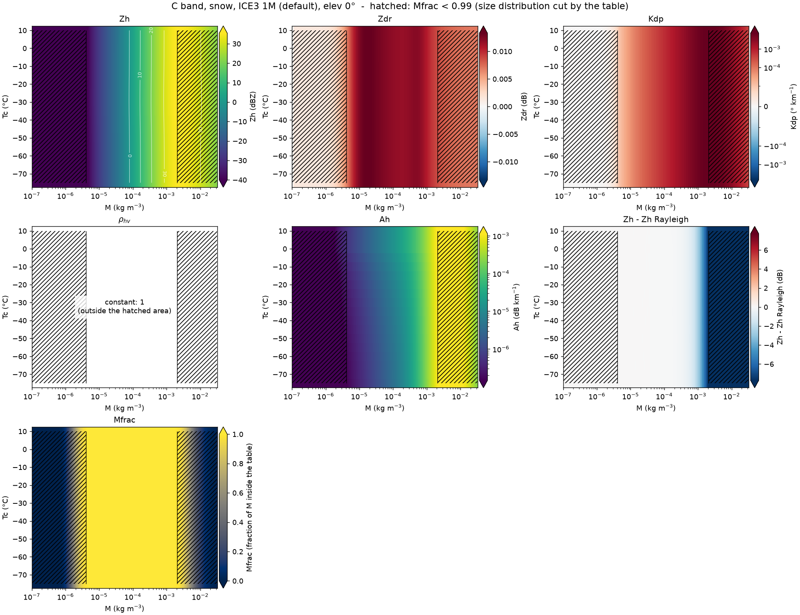
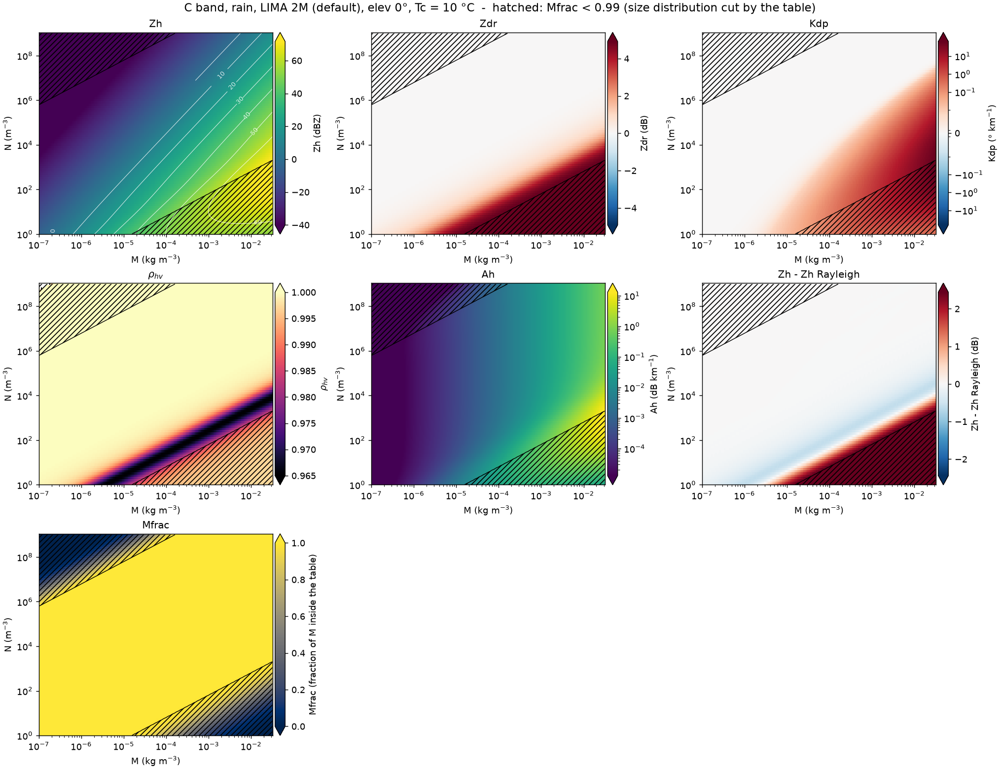
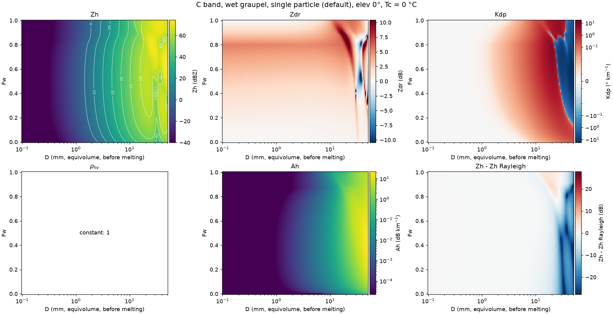
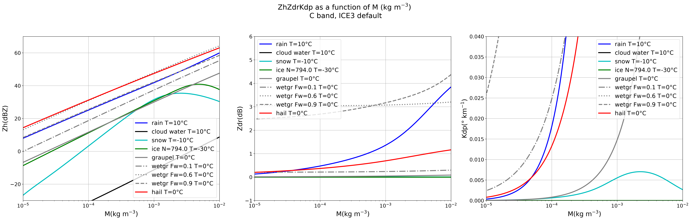

# Lookup tables: bug fixes, faster generation and new plot tools (November 2026)

Branch `fix-table-generator-bugs`. This report summarises all the changes to the table generator
(`tables_generator/`, `generate_tables.sh`), to the mixed phase in `operadar` and to the plot tools,
why they were made and what they change for users.

**What you need to do:** recompile `Tmat` and `TmatInt` and regenerate all the tables (delete the old
`TmatCoefDiff_*` / `TmatCoefInt_*` files first: `generate_tables.sh` keeps existing files). Almost every
table changes, because of the bug fixes and the new grids.

```bash
cd tables_generator/src && make -f makefile_createTable && make -f makefile_integrationOverPsd && cd ../..
./generate_tables.sh --default --band C -j 8      # about 5 minutes for C band (ICE3 + LIMA)
```

---

## 1. Summary

| Topic | Change | Effect |
|---|---|---|
| Correctness | Bugs fixed in `Tmat`, `TmatInt`, the parameter files and `generate_tables.sh` (section 2) | Zh changes of up to 0.4 dB (Ka/W), 11 dB (hail near 29 °C), wrong Zdr for wet graupel with canting, wrong 2-moment rows |
| Mixed phase | Wet hail was never computed; hail and rain were counted twice | Fixed in `mixed_phase.py`, new tests |
| Speed | Faster T-matrix loop, `-O2`, parallel generation (`-j N`), validated coarser grids | Full C band (8 types, ICE3 + LIMA) in ~5 min with `-j 8` |
| Accuracy | Grid study against finer references; Fw step 0.05 was too coarse | Fw step 0.01: wet graupel 0.4-0.7 dB more accurate |
| Coverage | New `Mfrac` column: fraction of the content inside the diameter range of the table | Shows where the size distribution is cut (values too low) |
| Plots | Plot scripts fixed for the new tables; new 2D maps of the full tables | See section 6 and `plot_tools/README.md` |
| Tests | pytest suite with an HTML report (237 tests) | `tests/tables_generator/README.md` |

---

## 2. Bug fixes

### T-matrix tables (`Tmatrix.f`)
- **Ice permittivity above 0 °C.** Hufford's (1991) formula for ice has a pole at 29.06 °C. Hail tables went up
  to 30 °C and were 11 dB too high near 29 °C (and the T-matrix did not converge at Ku band). Solid ice is now
  taken at min(T, 0 °C), and the hail tables stop at 0 °C (`Tcmax 0`). Above 0 °C, operadar uses the 0 °C values.
- **Canting width leak.** For wet graupel/hail with `canting=analyt`, the canting width was overwritten by the
  value of the previous diameter (e.g. Zdr 2.01 dB instead of 1.25 dB for D = 3.2 mm, Fw = 0.5, C band).
- **|K|²** was computed as Re(K²) instead of |K|² (up to 0.4 dB on Zh at Ka and W bands).
- **Density cap.** The mass-diameter laws gave densities above solid ice (up to 1900 kg/m³) for small snow and
  pristine ice, hence Zdr up to 10.7 dB for small plates. Now capped at 916 kg/m³.
- **`DIEL=MGwMA08`**: the water volume fraction was never computed (Zh decreased with Fw).
- **Silent stops.** When the T-matrix did not converge, `Tmat` stopped with exit status 0, so truncated tables went
  unnoticed (e.g. W-band hail stopped near 70 mm). It now fails with an error, and `NPN1` was raised to 160 so that
  100 mm hail converges at W band.

### Integrated tables (`TmatrixIntegration.f90`)
- **ICE3 PSD**: the intercept `No` used the slope `lambda` of the previous call (N(D) off by ~5, partly hidden by
  the mass rescaling).
- **2 moments**: the number of Fw values was overwritten, so rows were read at the wrong place when the T-matrix
  table had several Fw values (up to 0.4 dB).
- Wet species are now normalised like the other species; NaN guard also resets the rhohv accumulators; clear
  errors for unknown types or moments.

### Parameter files and script
- `TmatParam_K??` had the Ka wavelength (8.40 mm instead of 15.0 mm); `TmatParam_Xwh` had no band line;
  `Cwg_vertical` had no 90° elevation.
- `generate_tables.sh` failed on fresh clones (missing output folders), `--newConf` did not run `Tmat`, and failures
  were not reported. The unfinished edit mode was removed. The script now stops at once, with the commands to
  run, if `Tmat` or `TmatInt` has not been compiled.
- Snow tables now start at D = 0.01 mm (the ICE3 snow PSD is made of very small particles at low content).

### Mixed phase (`operadar/microphysics/mixed_phase.py`)
- With wet hail enabled, wet hail was never filled and hail was counted twice (dry and wet).
- `Fw_pos` counted the rain twice when wet hail was enabled. The melting-layer rain is now shared between wet
  graupel and wet hail in proportion to the graupel and hail contents, so that both get the liquid fraction
  Fw = rr / (rr + gg + hh) and the total content is conserved. Behaviour without wet hail is unchanged.
- New tests: `tests/test_mixed_phase.py`.

---

## 3. Faster table generation

| Step | Gain |
|---|---|
| T-matrix computed once per (Tc, Fw, D) and reused for every elevation | x1.9 (2 elevations) |
| Compilation with `-O2` (no optimisation before) | x2.8 on `Tmat` |
| `-j N`: `Tmat` and `TmatInt` run as N processes on blocks of temperatures | x2.6 more with `-j 8` (x13 in total with the two lines above) |
| Coarser grids validated by the grid study (section 4) | x5 to x100 depending on the type |

With these changes the whole C-band default set (cl, cs, rr, ii, ss, gg, hh, wg; ICE3 and LIMA) takes about
5 minutes with `-j 8`. Hail and wet hail are no longer computed at Ku, K, Ka and W bands (not needed for now;
`SKIP_TYPES` in `generate_tables.sh`).

---

## 4. Grid accuracy study and new grid steps

Each grid step was tested by building the tables with the real programs, emulating the linear interpolation of
operadar on the coarser grid, and comparing with a finer reference. Tolerances: Zh 0.05 dB, Zdr 0.02 dB,
rhohv 0.002, Kdp and Ah 1 %, in cells with Zh > -40 dBZ inside the table coverage.
Details and raw results: `tables_generator/tools/grid_study/SUMMARY.md`.

| Grid | Before | Now | Worst error at the new step |
|---|---|---|---|
| Diameter step ice, snow, graupel (Ku-W) | 0.005 / 0.001 / 0.002 | 0.02 | Zh ≤ 0.017 dB |
| Diameter step wet graupel, wet hail | 0.005 (L-X), 0.002 (Ku-W) | 0.02 | Zh ≤ 0.007 dB |
| Diameter step hail (L-X) | 0.01 | 0.02 | Zh 0.004 dB |
| Temperature step ice, snow | 1 °C | 5 °C | Zh ≤ 0.004 dB |
| Temperature step graupel, hail | 1 °C | 10 °C | Zh ≤ 0.006 dB |
| Temperature step rain, cloud | 1 °C | 5 °C (Ka rain: 2 °C) | Ah ≤ 0.5 % |
| Temperature step wet graupel, wet hail | 1 °C | 2 °C (1 °C at K, Ka, W) | |
| **Fw step wet graupel, wet hail** | **0.05** | **0.01** | 0.05 gave Zh errors of 0.4-0.7 dB |
| Content step (`expMstep`, TmatInt) | 0.01 | 0.02 | Zh ≤ 0.03 dB; Kdp 1.4-2.8 % for Ka rain and wet graupel |
| Concentration step (2 moments) | 0.1 | 0.1 | 0.2 would give 0.1-0.6 dB |

The Fw step is the only change that makes tables *more* accurate: Zh varies quickly with the first percent of
melt water (figure 1), and 0.01 is the finest step the parameter format allows.


*Figure 1. Wet graupel at C band, 0 °C, as a function of the content M and of Fw (new `plot_tables_2D.py`).*

---

## 5. Coverage of the size distributions (`Mfrac`) and low values

`TmatCoefInt_*` files have a new last column, `Mfrac`: the fraction of the content M whose particles lie inside
the diameter range of the table. Where Mfrac < 1, part of the distribution is missing and the radar variables
are too low. operadar does not read this column (it reads the columns by name).

Results (see also the hatched areas of figures 2 and 3):
- **Rain (ICE3 and LIMA), graupel, hail, wet graupel**: covered everywhere in realistic conditions.
- **Pristine ice**: cut only for mean masses above 3 mg per crystal (e.g. N = 1000 m⁻³ with M > 3 g/m³).
- **LIMA cloud**: cut only for mean drops above ~0.5 mm (drizzle, not cloud).
- **ICE3 snow**: the distribution goes beyond the table maximum (50 mm) from 2-3 g/m³ (Mfrac 0.91 at 3 g/m³,
  0.62 at 5 g/m³ at C band). The Zh bias stays small up to ~9.5 g/m³ because these very large, low-density flakes
  scatter little, but if your simulations have more than ~3 g/m³ of snow, consider a larger `expDmax` for snow.
- Particles below 10 µm are cut only in cells below -40 dBZ.


*Figure 2. ICE3 snow at C band. Hatched: Mfrac < 0.99 (left: particles smaller than the table, below -40 dBZ;
right: snow distribution beyond 50 mm).*


*Figure 3. LIMA rain at C band, 10 °C, as a function of M and N. The hatched corners are mean drop sizes outside
the table (huge drops at low N, tiny droplets at very high N).*

---

## 6. Plot tools

All the plot scripts now work with the new tables (`plot_tools/README.md` explains how to use each of them):
- **New `plot_tables_2D.py`**: 2D maps of the full tables (M-Tc, M-Fw, M-N for the integrated tables; D-Tc, D-Fw
  for single particles) for Zh, Zdr, Kdp, rhohv, Ah and Zh - Zh Rayleigh, with the coverage `Mfrac` hatched.
  Figure 4 shows the Mie resonances of large wet graupel at C band (negative Kdp, Zdr changing sign above ~20 mm).
- `plot_D_M_varpol_alltypes.py`, `plot_D_M_varpol_Rayleigh.py`, `plot_theoretical_varpol.py`: rows are selected at
  the closest grid value (with a warning) instead of exact equality, which gave empty curves when a requested
  value was not on the grid (e.g. hail at 1 °C). Also fixed: 2-moment species in `alltypes`, several variables in
  one figure, pandas 3 read-only arrays, missing matplotlib imports, figure folder path.


*Figure 4. Single wet graupel particle at C band, 0 °C, as a function of the diameter (before melting) and Fw.*


*Figure 5. Zh, Zdr and Kdp as a function of the content for all types (C band, ICE3), from
`plot_D_M_varpol_alltypes.py`.*

---

## 7. Tests

`tests/tables_generator/` builds `Tmat` and `TmatInt` in a sandbox and checks the physics (Rayleigh limit,
analytic Z and rain rate, symmetries, dry ice constant above 0 °C), the parameter files, the parallel generation
(-j N gives byte-identical tables) and `generate_tables.sh` (options, failures, missing programs).
`tests/test_mixed_phase.py` checks content conservation in the mixed phase. 237 tests pass. After each run, an
HTML report is written to `tests/tables_generator/report/test_report.html`.

```bash
pytest tests/tables_generator tests/test_mixed_phase.py
```
