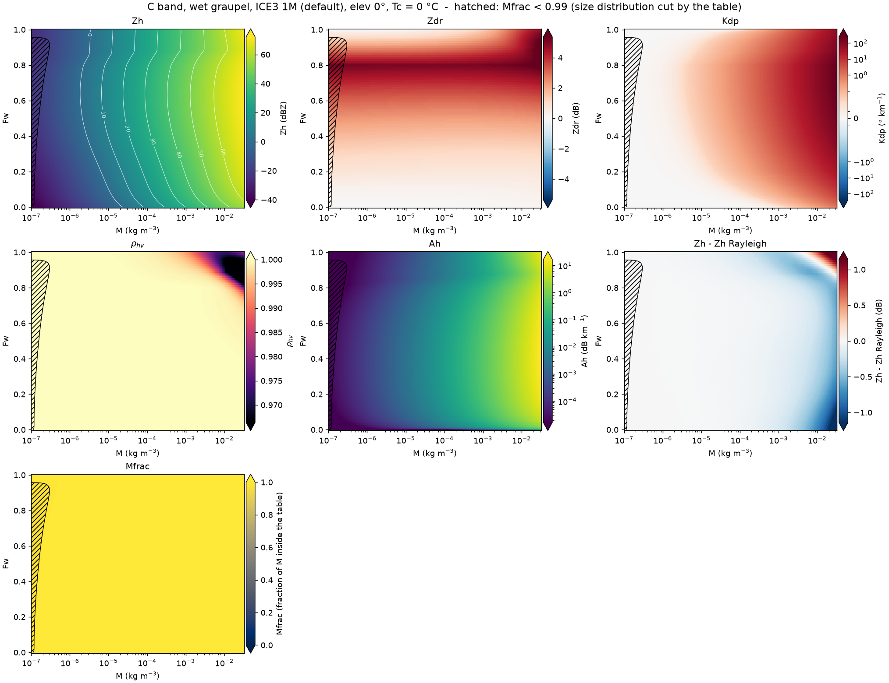
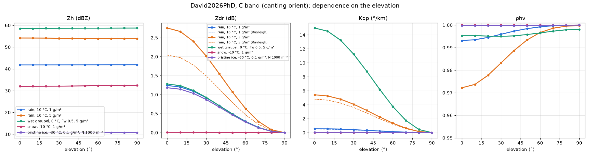
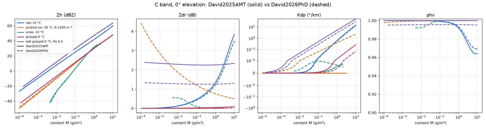
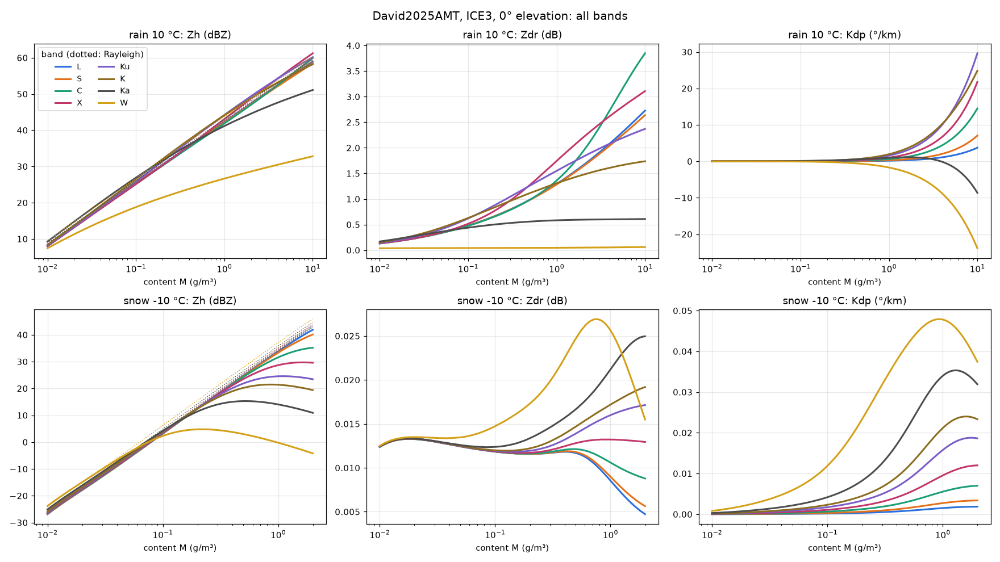

# Lookup tables: bug fixes, faster generation and new plot tools (November 2026)

Branch `fix-table-generator-bugs`. This report summarises all the changes to the table generator
(`tables_generator/`, `generate_tables.sh`), to the mixed phase in `operadar` and to the plot tools,
why they were made and what they change for users.

**What you need to do:** recompile `Tmat` and `TmatInt` and regenerate all the tables (delete the old
`TmatCoefDiff_*` / `TmatCoefInt_*` files first: `generate_tables.sh` keeps existing files). Almost every
table changes, because of the bug fixes and the new grids. Run the script in the operadar Python environment:
the tables are now written in NetCDF (section 9).

```bash
cd tables_generator/src && make -f makefile_createTable && make -f makefile_integrationOverPsd && cd ../..
./generate_tables.sh --default --band C -j 8      # default = David2026PhD (all bands)
./generate_tables.sh --David2025AMT --band C -j 8 # David2025AMT: C band only
```

---

## 1. Summary

| Topic | Change | Effect |
|---|---|---|
| Correctness | Bugs fixed in `Tmat`, `TmatInt`, the parameter files and `generate_tables.sh` (section 2) | Zh changes of up to 0.4 dB (Ka/W), 11 dB (hail near 29 °C), wrong Zdr for wet graupel with canting, wrong 2-moment rows |
| Mixed phase | Wet hail was never computed; hail and rain were counted twice | Fixed in `mixed_phase.py`, new tests |
| Speed | Faster T-matrix loop, `-O2`, parallel generation (`-j N`), validated coarser grids | Full C band (8 types, ICE3 + LIMA) in ~5 min with `-j 8` |
| Accuracy | Grid study against finer references; Fw step 0.05 was too coarse | Fw step 0.01: wet graupel 0.4-0.7 dB more accurate |
| Coverage | New `Mfrac` column: fraction of the content inside the diameter range of the table | Shows where the size distribution is cut (values too low) |
| Plots | Plot scripts fixed for the new tables; new 2D maps of the full tables | See section 6 and `plot_tools/README.md` |
| Configurations | `default` renamed `David2025AMT` (now C band only), `--default` = `David2026PhD` (all 8 bands), `vertical` removed, elevations 0-90° every 10° | See sections 8 and 9 |
| Canting and elevation | New `canting=orient` (averaging over orientations, valid at any elevation); Rayleigh columns now follow the elevation | See section 8, figures 6-8 |
| Temperature ranges | Graupel and hail -40 to 0 °C, wet graupel and wet hail -40 to 30 °C, in both configurations (23 Nov.) | Same results for dry species (identical rows above 0 °C removed); wet species follow the water permittivity up to 30 °C |
| Base files of `--newConf` | Now the David2026PhD configuration, at all bands (23 Nov.) | A new configuration starts from the default one |
| Table format | NetCDF instead of text (23 Nov.); operadar reads only the variables it needs | Tables 8-19 times smaller, operadar reads them 12 times faster with ~3 times less memory (section 9) |
| Wet hail | Wet hail tables computed (L, S, C, X), same sizes as hail (up to 100 mm) | Melting hail can be simulated (section 9) |
| ICE3 snow | Snow tables up to 158 mm (100 mm at W) instead of 50 mm | 99.9 % of the snow mass inside the table at 5 g/m³ (was 62 %) |
| Radar sensitivity | New threshold in operadar: no Zh, Zdr, Kdp, Rhohv below Zmin(r) = Zmin_1km + 20 log10(r/1 km) | Section 9 |
| Tests | pytest suite with an HTML report (412 tests) | `tests/tables_generator/README.md` |

---

## 2. Bug fixes

### T-matrix tables (`Tmatrix.f`)
- **Ice permittivity above 0 °C.** Hufford's (1991) formula for ice has a pole at 29.06 °C. Hail tables went up
  to 30 °C and were 11 dB too high near 29 °C (and the T-matrix did not converge at Ku band). Solid ice is now
  taken at min(T, 0 °C), and the graupel and hail tables stop at 0 °C (`Tcmax 0`, -40 to 0 °C). Above 0 °C, operadar uses the 0 °C values.
  Wet graupel and wet hail tables cover -40 to 30 °C (the water permittivity depends on the temperature).
- **Canting width leak.** For wet graupel/hail with `canting=analyt`, the canting width was overwritten by the
  value of the previous diameter (e.g. Zdr 2.01 dB instead of 1.25 dB for D = 3.2 mm, Fw = 0.5, C band).
- **|K|²** was computed as Re(K²) instead of |K|² (up to 0.4 dB on Zh at Ka and W bands).
- **Density cap.** The mass-diameter laws gave densities above solid ice (up to 1900 kg/m³) for small snow and
  pristine ice, hence Zdr up to 10.7 dB for small plates. Now capped at 916 kg/m³.
- **`DIEL=MGwMA08`**: the water volume fraction was never computed (Zh decreased with Fw).
- **Silent stops.** When the T-matrix did not converge, `Tmat` stopped with exit status 0, so truncated tables went
  unnoticed (e.g. W-band hail stopped near 70 mm). It now fails with an error, and `NPN1` was raised to 160 so that
  100 mm hail converges at W band.

### Integrated tables (`TmatrixIntegration.f90`)
- **ICE3 PSD**: the intercept `No` used the slope `lambda` of the previous call (N(D) off by ~5, partly hidden by
  the mass rescaling).
- **2 moments**: the number of Fw values was overwritten, so rows were read at the wrong place when the T-matrix
  table had several Fw values (up to 0.4 dB).
- Wet species are now normalised like the other species; NaN guard also resets the rhohv accumulators; clear
  errors for unknown types or moments.

### Parameter files and script
- `TmatParam_K??` had the Ka wavelength (8.40 mm instead of 15.0 mm); `TmatParam_Xwh` had no band line;
- `generate_tables.sh` failed on fresh clones (missing output folders), `--newConf` did not run `Tmat`, and failures
  were not reported. The unfinished edit mode was removed. The script now stops at once, with the commands to
  run, if `Tmat` or `TmatInt` has not been compiled.
- Snow tables now start at D = 0.01 mm (the ICE3 snow PSD is made of very small particles at low content).

### Mixed phase (`operadar/microphysics/mixed_phase.py`)
- With wet hail enabled, wet hail was never filled and hail was counted twice (dry and wet).
- `Fw_pos` counted the rain twice when wet hail was enabled. The melting-layer rain is now shared between wet
  graupel and wet hail in proportion to the graupel and hail contents, so that both get the liquid fraction
  Fw = rr / (rr + gg + hh) and the total content is conserved. Behaviour without wet hail is unchanged.
- New tests: `tests/test_mixed_phase.py`.

---

## 3. Faster table generation

| Step | Gain |
|---|---|
| T-matrix computed once per (Tc, Fw, D) and reused for every elevation | x1.9 (2 elevations) |
| Compilation with `-O2` (no optimisation before) | x2.8 on `Tmat` |
| `-j N`: `Tmat` and `TmatInt` run as N processes on blocks of temperatures | x2.6 more with `-j 8` (x13 in total with the two lines above) |
| Coarser grids validated by the grid study (section 4) | x5 to x100 depending on the type |

With these changes the whole C-band set (cl, cs, rr, ii, ss, gg, hh, wg; ICE3 and LIMA) took about
5 minutes with `-j 8` with 2 elevations. With the 10 elevations of section 8, one band takes 19 to 56 minutes with `-j 8`
for David2025AMT (C band 24 min, W band the slowest) and 31 to 45 minutes for David2026PhD (`canting=orient` needs
the amplitudes at 91 incidence angles). All the tables (David2025AMT 8 bands + David2026PhD L, S, C) took 6 hours
and took 133 GB. On 23 November the graupel, hail and wet graupel tables were regenerated with the new
temperature ranges of section 8 (see section 10 for the status). Hail and wet hail are no longer computed at Ku, K, Ka and W bands (not needed for now;
`SKIP_TYPES` in `generate_tables.sh`).

---

## 4. Grid accuracy study and new grid steps

Each grid step was tested by building the tables with the real programs, emulating the linear interpolation of
operadar on the coarser grid, and comparing with a finer reference. Tolerances: Zh 0.05 dB, Zdr 0.02 dB,
rhohv 0.002, Kdp and Ah 1 %, in cells with Zh > -40 dBZ inside the table coverage.
Details and raw results: `tables_generator/tools/grid_study/SUMMARY.md`.

| Grid | Before | Now | Worst error at the new step |
|---|---|---|---|
| Diameter step ice, snow, graupel (Ku-W) | 0.005 / 0.001 / 0.002 | 0.02 | Zh ≤ 0.017 dB |
| Diameter step wet graupel, wet hail | 0.005 (L-X), 0.002 (Ku-W) | 0.02 | Zh ≤ 0.007 dB |
| Diameter step hail (L-X) | 0.01 | 0.02 | Zh 0.004 dB |
| Temperature step ice, snow | 1 °C | 5 °C | Zh ≤ 0.004 dB |
| Temperature step graupel, hail | 1 °C | 10 °C | Zh ≤ 0.006 dB |
| Temperature step rain, cloud | 1 °C | 5 °C (Ka rain: 2 °C) | Ah ≤ 0.5 % |
| Temperature step wet graupel, wet hail | 1 °C | 2 °C (1 °C at K, Ka, W) | |
| **Fw step wet graupel, wet hail** | **0.05** | **0.01** | 0.05 gave Zh errors of 0.4-0.7 dB |
| Content step (`expMstep`, TmatInt) | 0.01 | 0.02 | Zh ≤ 0.03 dB; Kdp 1.4-2.8 % for Ka rain and wet graupel |
| Concentration step (2 moments) | 0.1 | 0.1 | 0.2 would give 0.1-0.6 dB |

The Fw step is the only change that makes tables *more* accurate: Zh varies quickly with the first percent of
melt water (figure 1), and 0.01 is the finest step the parameter format allows.


*Figure 1. Wet graupel at C band, 0 °C, as a function of the content M and of Fw (new `plot_tables_2D.py`,
David2026PhD tables). The horizontal line at Fw = 0.8 is not a bug: the axis ratio law of Ryzhkov et al. (2011,
`RYwg`) is continuous but has its minimum (0.56) at Fw = 0.8, so Zdr is largest and rhohv has a kink there.*

---

## 5. Coverage of the size distributions (`Mfrac`) and low values

`TmatCoefInt_*` files have a new last column, `Mfrac`: the fraction of the content M whose particles lie inside
the diameter range of the table. Where Mfrac < 1, part of the distribution is missing and the radar variables
are too low. operadar does not read this column (it reads the columns by name).

Results (see also the hatched areas of figures 2 and 3):
- **Rain (ICE3 and LIMA), graupel, hail, wet graupel**: covered everywhere in realistic conditions.
- **Pristine ice**: cut only for mean masses above 3 mg per crystal (e.g. N = 1000 m⁻³ with M > 3 g/m³).
- **LIMA cloud**: cut only for mean drops above ~0.5 mm (drizzle, not cloud).
- **ICE3 snow**: with the former 50 mm limit, the distribution went beyond the table from 2-3 g/m³ (Mfrac 0.91 at
  3 g/m³, 0.62 at 5 g/m³ at C band). The snow tables now go up to 158 mm (100 mm at W band): Mfrac ≥ 0.999 up to
  5 g/m³ (section 9).
- Particles below 10 µm are cut only in cells below -40 dBZ.


*Figure 2. ICE3 snow at C band. Hatched: Mfrac < 0.99 (left: particles smaller than the table, below -40 dBZ;
right: snow distribution beyond 50 mm).*


*Figure 3. LIMA rain at C band, 10 °C, as a function of M and N. The hatched corners are mean drop sizes outside
the table (huge drops at low N, tiny droplets at very high N).*

---

## 6. Plot tools

Figures 1 to 5 were made with the final David2026PhD tables. All the plot scripts now work with the new tables (`plot_tools/README.md` explains how to use each of them):
- **New `plot_tables_2D.py`**: 2D maps of the full tables (M-Tc, M-Fw, M-N for the integrated tables; D-Tc, D-Fw
  for single particles) for Zh, Zdr, Kdp, rhohv, Ah and Zh - Zh Rayleigh, with the coverage `Mfrac` hatched.
  Figure 4 shows the Mie resonances of large wet graupel at C band (negative Kdp, Zdr changing sign above ~20 mm).
- `plot_D_M_varpol_alltypes.py`, `plot_D_M_varpol_Rayleigh.py`, `plot_theoretical_varpol.py`: rows are selected at
  the closest grid value (with a warning) instead of exact equality, which gave empty curves when a requested
  value was not on the grid (e.g. hail at 1 °C). Also fixed: 2-moment species in `alltypes`, several variables in
  one figure, pandas 3 read-only arrays, missing matplotlib imports, figure folder path.


*Figure 4. Single wet graupel particle at C band, 0 °C, as a function of the diameter (before melting) and Fw.*


*Figure 5. Zh, Zdr and Kdp as a function of the content for all types (C band, ICE3, David2026PhD; the Kdp axis of the script stops at 0.04 °/km to show the small values), from
`plot_D_M_varpol_alltypes.py`.*

---

## 7. Tests

`tests/tables_generator/` builds `Tmat` and `TmatInt` in a sandbox and checks the physics (Rayleigh limit,
analytic Z and rain rate, symmetries, dry ice constant above 0 °C), the parameter files, the parallel generation
(-j N gives byte-identical tables) and `generate_tables.sh` (options, failures, missing programs).
It also checks the predefined configurations (options of the thesis Table 4.3 at every band, elevations 0-90°),
`canting=orient` (equal to `nocant` without canting, equal to `analyt` at low elevation, Zdr = Kdp = 0 at 90°), the
Rayleigh columns at elevation and the `--default` alias. `tests/test_mixed_phase.py` checks content conservation
in the mixed phase, `tests/test_tables_io_sensitivity.py` the NetCDF tables and the sensitivity threshold.
All tests pass (23 November 2026). After each run, an
HTML report is written to `tests/tables_generator/report/test_report.html`.

```bash
pytest tests/tables_generator tests/test_mixed_phase.py tests/test_tables_io_sensitivity.py
```

---

## 8. Configurations and elevations

- **`default` renamed `David2025AMT`**: the configuration of [David et al. (2025)](https://doi.org/10.5194/amt-18-3715-2025),
  no canting and spherical pristine ice. Its parameter files differed between bands (X band had canting for all
  types and oblate snow, copied from another configuration by mistake; Ku to W had plate-like pristine ice
  (AR 0.2) and `CNST` 0.6 snow; S band had snow AR 0.80 instead of 0.75); they were first made identical at all
  bands. **On 23 November it was reduced to C band** (the only band needed to reproduce the publication); its
  files at the other bands and their tables were deleted.
- **`--default` is an alias for `--David2026PhD`**: tables in `tables/David2026PhD/`, used by the operadar
  configuration templates. David2026PhD existed at L, S and C; **on 23 November it was extended to all 8 bands**
  (X, Ku, K, Ka, W: the wavelength and grids of each band with the David2026PhD options). A test checks that the
  8 bands share the same microphysical options. For a band without files (David2025AMT outside C) the script
  stops and lists the available bands.
- **`vertical` removed**: all configurations now cover **0 to 90 degrees every 10 degrees**. Before, L to X tables had
  0 and 10 degrees only, and operadar used the 10 degree values at higher elevations (C-band rain, 5 g/m³, 30 degrees:
  Zdr 2.92 dB instead of 2.22 dB, Kdp +29 %). With a 10 degree step, the interpolation error is ≤ 0.03 dB on Zh,
  ≤ 0.06 dB on Zdr and ≤ 1 % of the 0 degree value on Kdp (grid study, `results/elev_ranges.txt`). The tables are
  5 times larger.
- Summary of the configurations, their differences and their impact on the radar variables:
  `docs/wiki/Lookup-table-configurations.md` (wiki page).
- **Canting at any elevation** (new option `canting: orient`, used by David2026PhD). The analytical angular moments
  of Ryzhkov et al. (2011, eq. 20) (`canting: analyt`) assume a horizontal beam; at higher elevations they were
  applied to the amplitudes of an aligned particle (at 90 degrees: same result as without canting). `orient`
  averages the T-matrix amplitudes over the orientations of the particles (Gaussian distribution of the axis around
  the vertical, uniform azimuth, as in pytmatrix), using the amplitudes as a function of the angle between the beam
  and the axis, so it is valid at any elevation. At 0 degrees it gives the same results as `analyt` (Zdr within
  0.003 dB, Zh within 0.03 dB, same Kdp for David2026PhD C band); at higher elevations Zdr and Kdp hardly change,
  but `analyt` overestimated rhohv (wet graupel at 60 degrees: 1.000 instead of 0.996) and the Zh of wet graupel
  (+0.3 to 0.4 dB at 60-90 degrees). `analyt` is kept (with a warning above 10 degrees).
- **Rayleigh columns at elevation**: they were computed at 0 degrees for every elevation (Zdr of 2.25 dB at vertical
  incidence for L-band rain). The Rayleigh amplitude in vertical polarisation now follows the elevation
  (S_v = S_b + (S_a - S_b) cos^2(elevation)), and the Rayleigh and T-matrix columns agree for small particles at all
  elevations. operadar uses the Rayleigh columns only with `scattering_method = 'Rayleigh'` or `'both'`.
- **Temperature ranges of graupel and hail (decided 23 November 2026)**, the same in both configurations:

  | Type | Before (David2025AMT / David2026PhD) | Now (both) |
  |---|---|---|
  | graupel | -40 to 10 / -60 to 10 °C | -40 to 0 °C |
  | hail | -40 to 0 / -40 to 30 °C | -40 to 0 °C |
  | wet graupel | -40 to 10 / -40 to 10 °C (L: -60 to 30) | -40 to 30 °C |
  | wet hail (param files only) | -40 to 10 / -60 to 40 °C | -40 to 30 °C |

  Dry species: solid ice is computed at min(T, 0 °C) and nothing else depends on the temperature, so the rows above
  0 °C were identical and operadar now uses the 0 °C values (no change in the results). Wet species: the water
  permittivity is computed at the true temperature, so the rows above 0 °C differ; 30 °C covers graupel falling
  below the melting layer. In operadar the mixed phase is not defined by the temperature but where rain coexists
  with graupel or hail (Fw = rr / (rr + gg + hh)), so it also occurs below 0 °C with supercooled rain.
- **Wet hail is not computed** (`wh` is not in `HYDRO_LIST` of `generate_tables.sh`): without wet hail tables,
  operadar keeps hail dry in the mixed phase (computed at 0 °C) and only graupel becomes wet. To be decided whether
  wet hail tables should be added (a few hours per configuration).
- **Base files of `--newConf` (decided 23 November 2026)**: `TmatParam_<band><type>` are now the David2026PhD
  configuration: exact copies at L, S and C bands; at X, Ku, K, Ka and W the David2025AMT file of the band
  (wavelength, grids) with the David2026PhD options (canting, axis ratios, temperature ranges). Before, they matched
  neither configuration (e.g. rain canting 10° with `analyt`, `Frim 0.0` at X band, old elevations), and Ka and Ku
  had no base files (so `--newConf` failed at these bands).



*Figure 6. Radar variables as a function of the elevation (David2026PhD, C band, `canting=orient`). Zh hardly
changes; Zdr and Kdp decrease to 0 at 90°; rhohv goes to 1 at 90° for rain (oblate drops seen from below look
round). Dashed: Rayleigh columns of the rain tables, which now follow the elevation (C band: Mie effects raise Zdr
above the Rayleigh value for heavy rain).*


*Figure 7. David2025AMT (solid) and David2026PhD (dashed) at C band, 0° elevation, where the size distribution is
inside the table (Mfrac > 0.99). Main differences: pristine ice (Zdr 0 dB for spheres, 0.5 to 4 dB for plates
of AR 0.2), snow (Zdr up to 0.6 dB at low content with AR 0.6), wet graupel (Zdr and Kdp about halved by the
canting) and graupel Kdp. Rain changes little (canting 10°). Kdp axis: symmetric log scale, linear below 0.01 °/km.*


*Figure 8. David2025AMT rain and snow at the 8 bands (ICE3, 0° elevation; dotted: Rayleigh). Attenuation is not
included. Mie effects reduce Zh from Ka band for rain and from C band for snow above ~0.5 g/m³; rain Kdp becomes
negative at W band and at Ka band above ~4 g/m³ (large drops).*

---

## 9. Changes of 23 November 2026: NetCDF tables, wet hail, snow, radar sensitivity

### NetCDF tables
The text tables repeated the grid (Tc, ELEV, P3, M or D) on every row and wrote each value with 11 characters.
`generate_tables.sh` now converts each table to NetCDF (`<table>.nc`) as soon as it is written, and deletes the
text file:

- each column is a variable on the grid of the table: dimensions `(Tc, ELEV, Fw, M)` for 1-moment species,
  `(Tc, ELEV, N, M)` for 2-moment species and pristine ice, `(Tc, ELEV, Fw, D)` for the single-particle tables;
  the header parameters are global attributes; values in single precision (as computed by the Fortran programs),
  compressed (zlib);
- **8 to 19 times smaller** (e.g. LIMA 2-moment rain at C band: 1445 MB → 128 MB; ICE3 pristine ice:
  1239 MB → 66 MB); the David2026PhD tables of a band take about 1 GB instead of 13 GB;
- values identical to the text tables to single precision (relative difference ≤ 6·10⁻⁸; the `Infinity` of the
  rhohv column are stored as NaN, as operadar always read them);
- `TmatInt` still reads text single-particle tables: when an integrated table has to be computed again, the
  script writes the text file back from the NetCDF file (byte-identical integrated table, checked), then deletes it;
- `--text` keeps the text tables; the conversion needs a Python with xarray and netCDF4 (operadar environment, or
  `PYTHON=/path/to/python`); the script stops at once with a message otherwise;
- new module `operadar/read/table_io.py` (conversion both ways, reading of NetCDF or text tables), used by
  operadar, the plot tools and `generate_tables.sh`. Text tables of older versions are still read.

**operadar reads only the variables it needs** (e.g. `sighh`, `sigvv`, `kdp`, `REdeltaco`, `IMdeltaco`, `Ah`
for Zh, Zdr, Kdp, Rhohv, Ah) instead of the 26 columns: C-band rain and pristine ice tables are read in 1.7 s
instead of 20.7 s, with identical arrays. The values are converted to double precision for the computations
(products like σhh·σvv would underflow in single precision).

The tables can be plotted directly with xarray (see the wiki page *Generation of the lookup tables*), and all the
plot tools read them (checked with `plot_tables_2D.py`).

### Wet hail
`wh` was added to the types computed by `generate_tables.sh` (L, S, C and X bands; hail and wet hail are still
skipped at Ku, K, Ka and W). Its diameter range was extended from 50 to 100 mm, like hail: in the mixed phase
(`Fw_pos`, `Fw_posg`) all the hail content goes to wet hail. The T-matrix converges up to 100 mm for Fw from 0 to 1
at C and X bands (checked). To use it in operadar, add `'hh':1,'wh':1` to `hydrometeors_moments`.

### ICE3 snow at high content
`expDmax` of snow raised from 1.7 (50 mm) to 2.2 (158 mm), and 2.0 (100 mm) at W band where the T-matrix does not
converge beyond ~110 mm (checked up to 200 mm at X, Ku, K and Ka bands). Fraction of the snow mass inside the
table (`Mfrac`, S band, -10 °C): 1.000 up to 3 g/m³, 0.999 at 5 g/m³, 0.98 at 7 g/m³, 0.87 at 10 g/m³ (it was
0.91 at 3 g/m³ and 0.62 at 5 g/m³).

### Radar sensitivity (operadar)
New module `operadar/radar/sensitivity.py`. Where Zh is below the minimum detectable reflectivity

    Zmin(r) = Zmin_1km + 20 log10(r / 1 km)

Zh, Zdr, Kdp and Rhohv (and `Zh_att`, which is used instead of Zh when the attenuation is computed) are set to NaN,
so that no polarimetric variable (rhohv especially) is computed from an extremely small signal. The range r is
known with the radar geometry (`radarloc`) and for a vertically pointing radar (`cnst_angle = 90`:
|altitude − radar_altitude|); otherwise the threshold is constant. New configuration options
`sensitivity_threshold = True` and `Zmin_1km = None` (default per band: -30 dBZ at L, S, C, X; -40 at Ku, K, Ka;
-50 at W; these are orders of magnitude, to be set for a given radar). Description for the wiki:
`docs/wiki/Simulation-configuration.md` (section Radar sensitivity).

---

## 10. Still to decide

- The default sensitivity thresholds per band (section 9) are orders of magnitude: to be checked against the
  radars you simulate.
- Hail and wet hail are still not computed at Ku, K, Ka and W bands (`SKIP_TYPES`).
- All elevations (0 to 90° every 10°) are kept on purpose: the next step is a real radar geometry in
  `operadar/radar/geometry.py` (PPI at several elevations, RHI). Notes for that work: `compute_radar_elevation`
  resets every elevation to 0 (`elev[:,:,:]=0.`, present since the first commit), so only `cnst_angle` is used
  today; and with `radarloc = [lat, lon]` the radar position `X0, Y0, Z0` is never set (only `'center'` works).
- Old table folders that can be deleted: `tables_generator/tables/vertical/` (2.4 GB) and
  `tables_generator/tables/default_old/` (7.2 GB).

---

## 11. Status before commit and push (23 November 2026)

**On the branch** `fix-table-generator-bugs` (7 commits ahead of `master`, **nothing pushed**: the branch does
not exist on GitHub yet): aebe411, 8f1e435, 820bca0, d9f06a7, c9d5b78, db3c444, b8c662f.
The tables themselves and this HTML report are not in git (`.gitignore`).

**Not committed yet** (changes of 23 November):
- parameter files: graupel/hail temperature ranges, snow and wet hail diameter ranges, David2026PhD files at X,
  Ku, K, Ka, W (45 new) and S-band wet hail, David2025AMT files outside C band removed (63), base files
  rewritten (David2026PhD) and new Ka/Ku base files;
- `generate_tables.sh` (NetCDF conversion, `--text`, wet hail), `operadar/read/table_io.py` (new),
  `operadar/read/lookup_tables.py`, `operadar/radar/sensitivity.py` (new), `operadar/radar/geometry.py` (returns the
  range), `operadar/forward_operator.py`, configuration files, plot tools, `make_figures.py`;
- tests (`tests/tables_generator/`, new `tests/test_tables_io_sensitivity.py`), this report and the wiki drafts.

**Running**: regeneration (started 23 November, in NetCDF): David2026PhD L, C, X, Ku, K, Ka, W, then David2025AMT C,
then S band again for wet hail (log: `tables_generator/tables/run_all_tables.log`). Already done: David2026PhD
S band (all types except wet hail). Old tables: `tables_generator/tables/_backup_Tc_2026-11-21/` (graupel, hail,
wet graupel) and `_backup_snow_2026-11-23/` (snow).

**Checklist**

| Item | Status |
|---|---|
| Temperature ranges, base files, wet hail, snow range, NetCDF, reading, sensitivity | done; 412 tests pass |
| Report and wiki drafts updated | done |
| Tables regenerated (all bands David2026PhD, C band David2025AMT) | running (about 15-20 h: 5 new bands with all types) |
| Check the new tables (no failure in the logs, convergence of snow at W band and of wet hail, one plot per type) | after the run |
| Redraw the report figures with the new tables (annex C graupel/hail maps made with the old ranges) | after the run |
| Commit the 23 November changes | after your review |
| Push the branch and open a pull request to `master` | after your OK |
| Publish `docs/wiki/` to the GitHub wiki (automatic on master, `.github/workflows/wiki.yml`) | after your OK |
| Delete `tables/vertical/`, `tables/default_old/`, the two `_backup_*` folders | your choice |
| Stray PNGs in `operadar/radar/` | left untracked on purpose |
