# Analysis of an operadar output with the new plot tools (November 2026)

This report applies all the new analysis tools of `plot_tools/` to the AROME output available in the repository:

| | |
|---|---|
| File | `operadarFiles/AROME/dpolvar_Arome_ICE3_Cband_20250831_1800.nc` (run of 20 Nov. 2026) |
| Case | AROME, ICE3, 31 August 2025 18 UTC, 130 x 119 points at 1.3 km, 90 levels (lon 2-4° E, lat 45-46.5° N) |
| Radar | C band, T-matrix, mixed phase `Fw_posg`, no radar location (vertical geometry), attenuation computed (`Ah`, `Zh_att`) |
| Comparison | the same model file processed in April 2026 (`modelFiles/AROME/ncfiles/`, section 5) |

There are no observations for this case, so the CFADs compare **three selections of the simulation** (storm
cores, storm envelopes, all points) instead of simulations and observations. With observations, the same
commands give the figures of David et al. (2025, AMT). The tool for the maximum over several times
(`plot_max_over_time.py`) needs several time steps and is not used here.

**Reproduce:** from the repository root, in the operadar Python environment
(`bash docs/reports/figures_2026-11_outputs/make_figures.sh`, about 75 s). The script lists every command.
Sections 6-8 (current code, .fa file, W band, MesoNH): `make_figures_fa.sh`.

---

## 1. Summary

| Topic | Result |
|---|---|
| Structure | A south-north convective line near 2.5° E, with Zh up to 52 dBZ, Kdp up to 8.6 °/km, and smaller cells to the north-east (Fig. 1) |
| Storm cells | 18 cores (column max Zh >= 40 dBZ, 2867 columns) inside the envelopes (Zmax >= 25 dBZ, 8208 columns) |
| Vertical structure | Melting layer about 3-3.5 km above the lowest level; bright band Zh 39 dBZ and Kdp peak 0.5 °/km at 2.5 km in the cores; rain Zdr about 1 dB; Zdr and Kdp close to 0 in ice (Fig. 4) |
| Rain towards the ground | In the cores, Zh decreases from 39 dBZ (2.5 km) to 34 dBZ (ground) and the rain content from 0.58 to 0.36 g/m³ (evaporation), the ICE3 behaviour described in David et al. (2025, Sect. 4.3.1) |
| Checks | Rain consistent (Zdr and Kdp increase with Zh, Fig. 2). **Two problems**: no radar sensitivity threshold (Zh down to -418 dBZ: the run is older than the threshold), and ~6500 false echoes at exactly 0 dBZ in ice with almost no content (section 2) |
| April vs November | Zh, Zdr, Kdp, Ah almost unchanged (rain: < 0.05 dB mean, Kdp in the melting layer up to -0.07 °/km); **Zh_att now has values in ice too** (only at T >= 0 °C in April), and differs in the melting layer (RMSE 5.6 dB) (section 5) |
| Current code (section 6) | Recomputed from the .fa file: sensitivity threshold applied (Zh >= -30 dBZ), no false echo at 0 dBZ, table configuration in the attributes; David2026PhD tables: Zdr +0.36 dB in ice (up to 1.25 dB median at 10 km in the cores), -0.17 dB in the melting layer, Zh within 0.2 dB; Zh_att identical to the 20 Nov. attenuation |
| W band (section 7) | Zh 9-16 dB lower than at C band (rain saturates near 22 dBZ), Zdr of rain ~0, Kdp negative in rain and ~15 x C band in ice, Ah up to 45 dB/km: all expected in the Mie regime. A radar at the ground looking up sees Zh_att -6 dBZ at 2 km in the cores. CFADs in the C band cores (`--cells-from`) |
| MesoNH (section 8) | MesoNH reading was broken (5 bugs, also on master), fixed and tested. Cyclone near La Réunion (subdomain; the whole domain does not fit in memory): rain Zh 42 dBZ, Zdr 1.2 dB constant down to the sea, melting layer 4.5-5.5 km. The former output has 1.37 million false 0 dBZ echoes |

---

## 2. Quick look and checks (`plot_output_check.py`)

```bash
python plot_output_check.py ../operadarFiles/AROME/dpolvar_Arome_ICE3_Cband_20250831_1800.nc
```

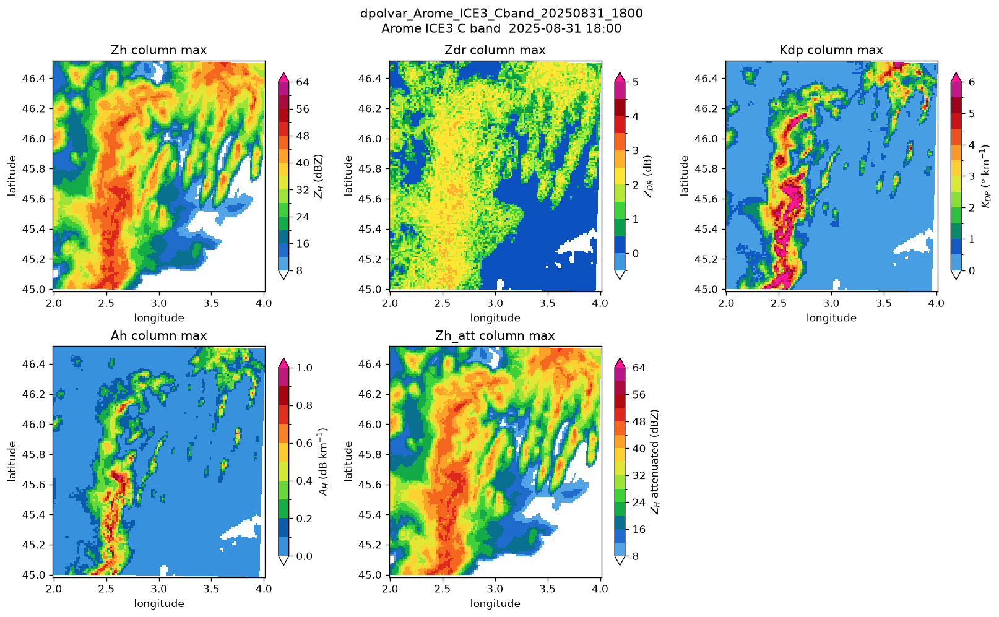

*Figure 1: column maximum of Zh, Zdr, Kdp, Ah and Zh_att.*

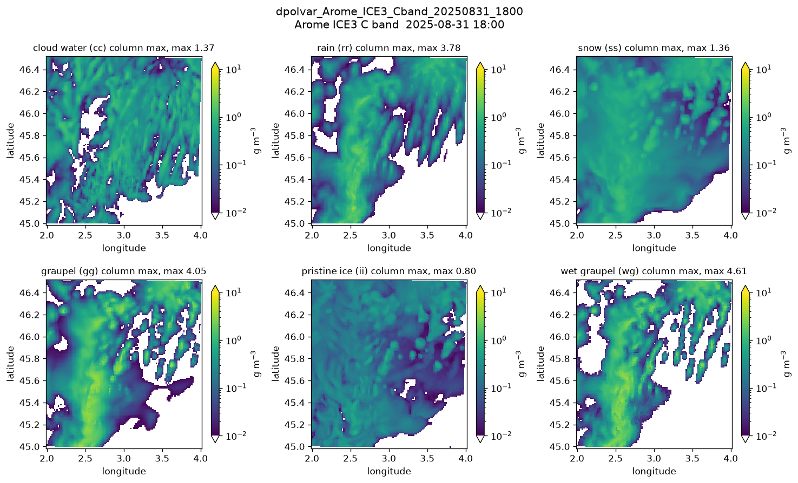

*Figure 1b: column maximum of each hydrometeor content (log scale).*

Summary printed by the script (`figures_2026-11_outputs/check/..._check.txt`):

| Variable | Valid points | NaN | Min | P50 | P99 | Max |
|---|---|---|---|---|---|---|
| Zh (dBZ) | 957 004 | 31 % | -417.8 | 17.3 | 42.3 | 52.0 |
| Zdr (dB) | 950 507 | 32 % | 0.00 | 0.04 | 1.58 | 2.74 |
| Kdp (°/km) | 957 004 | 31 % | 0.00 | 0.002 | 1.03 | 8.65 |
| Ah (dB/km) | 957 004 | 31 % | 0.00 | 0.00 | 0.10 | 1.00 |
| Zh_att (dBZ) | 952 815 | 32 % | -150.0 | 17.4 | 42.1 | 51.0 |

Maximum contents: rain 3.8, graupel 4.0, wet graupel 4.6, cloud water 1.4, snow 1.4, pristine ice
0.8 g/m³. Fw of the wet graupel is rebuilt for 77 165 points (median 0.94).

**Problems found:**

1. **No radar sensitivity:** 46 307 points have Zh < -30 dBZ (minimum -418 dBZ). The file was computed on
   20 Nov., before the sensitivity threshold (`sensitivity_threshold`, 23 Nov.). Recompute it with the current
   code before using it for comparisons with observations.
2. **False echoes at 0 dBZ:** 6497 points have **exactly Zh = 0 dBZ** (with Zdr = NaN), in ice (T between -56 and
   -3 °C) where the total content is below 0.001 g/m³. The April run has the same problem (7825 points). These
   are not real echoes: the reflectivity of such tiny contents is far below 0 dBZ. A sensitivity threshold of
   a few dBZ would remove them, but they would come back with a lower threshold. The uncommitted change in
   `operadar/radar/dualpol_variables.py` (comment line 234: "would write Zh = 0 dBZ there, a false echo") seems
   to address this case. To be confirmed by recomputing this file.

No point has precipitation (contents >= 0.1 g/m³) without Zh, so no content or temperature is outside the
tables.

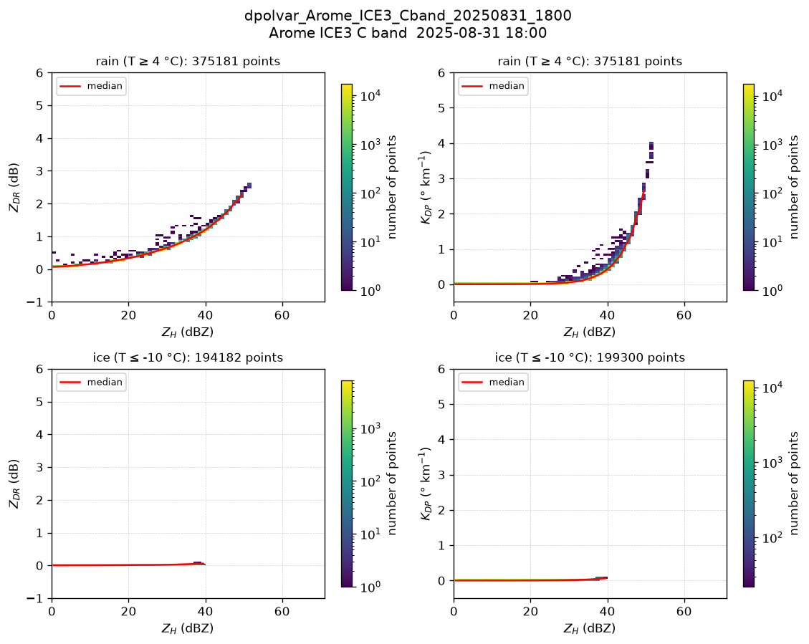

*Figure 2: Zh-Zdr and Zh-Kdp in rain (T >= 4 °C, top) and in ice (T <= -10 °C, bottom), with the median (red).*

In rain, Zdr increases smoothly with Zh (0.1 dB at 0 dBZ, 1 dB at 35 dBZ, 2.5 dB at 52 dBZ), and Kdp exceeds
0.1 °/km above about 35 dBZ, as expected from drop size distributions. In ice, Zdr and Kdp stay close to 0 and
Zh below 40 dBZ. Ice is therefore almost spherical in this run. The output does not record which table
configuration was used, so this cannot be checked from the file. With the David2026PhD tables (oblate pristine
ice and snow), positive Zdr would be expected in ice. Writing the table configuration in the output
attributes would help.

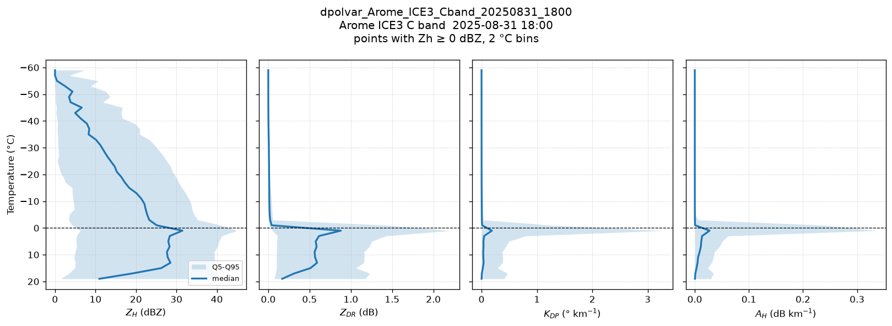

*Figure 3: median and Q5-Q95 of each variable as a function of temperature (points with Zh >= 0 dBZ).*

The melting layer is clear just below 0 °C: Zh peak (bright band), Zdr up to 0.9 dB (median), Kdp and Ah peaks.
Zh decreases regularly with temperature in ice, from 23 dBZ at 0 °C to 0 dBZ at -60 °C.

---

## 3. CFADs (`compute_cfad.py`, `plot_cfad.py`)

```bash
python compute_cfad.py FILE --mask core     --label "cores (Zmax >= 40 dBZ)"     --out stats/core.nc
python compute_cfad.py FILE --mask envelope --label "envelopes (Zmax >= 25 dBZ)" --out stats/envelope.nc
python compute_cfad.py FILE --mask all      --label "all points"                 --out stats/all.nc
python plot_cfad.py stats/core.nc stats/envelope.nc stats/all.nc --colors tab:red tab:orange tab:blue --hmax 13
```

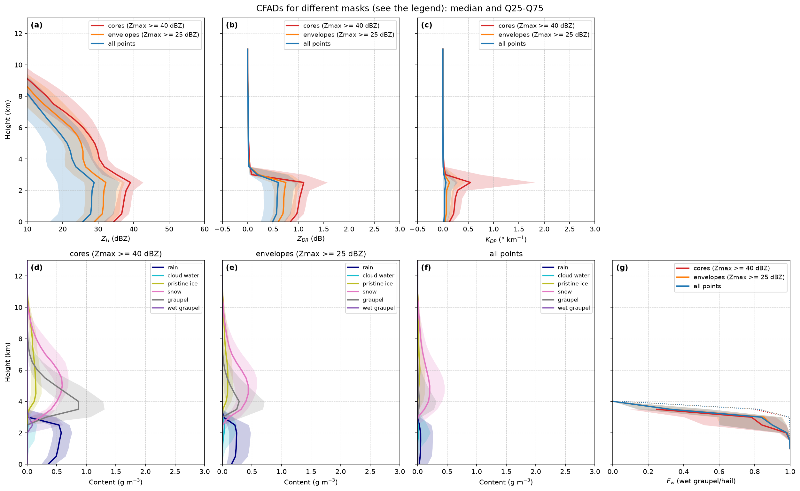

*Figure 4: CFADs (median and Q25-Q75) in the cores (red), envelopes (orange) and all points (blue), with the
layout of Fig. 6 of David et al. (2025): (a-c) radar variables, (d-f) contents, (g) Fw of the wet graupel
(Q95 dotted). Heights above the lowest model level.*

Medians in the cores:

| Height (km) | Zh (dBZ) | Zdr (dB) | Kdp (°/km) | Rain (g/m³) | Graupel (g/m³) | Snow (g/m³) | Fw |
|---|---|---|---|---|---|---|---|
| 0 | 34.4 | 0.84 | 0.13 | 0.36 | 0 | 0 | |
| 1 | 37.1 | 1.00 | 0.23 | 0.52 | 0 | 0 | 1.00 |
| 2 | 37.9 | 1.07 | 0.29 | 0.58 | 0 | 0 | 0.98 |
| 2.5 | 39.1 | 1.11 | 0.54 | 0.54 | 0 | 0 | 0.84 |
| 3 | 35.2 | 0.08 | 0.05 | 0.02 | 0.32 | 0.23 | 0.78 |
| 3.5 | 31.8 | 0.04 | 0.02 | 0 | 0.86 | 0.40 | 0.25 |
| 4 | 30.3 | 0.03 | 0.02 | 0 | 0.87 | 0.50 | |
| 6 | 25.8 | 0.01 | 0.01 | 0 | 0.17 | 0.52 | |
| 8 | 15.5 | 0.01 | 0.00 | 0 | 0.01 | 0.15 | |
| 10 | 5.6 | 0.00 | 0.00 | 0 | 0 | 0.02 | |

* **Below the melting layer**, the cores have about 6 dB more Zh and 0.3 dB more Zdr than the envelopes and more
  than twice the rain content (at 2 km: 37.9 vs 31.7 dBZ, 1.07 vs 0.73 dB, 0.58 vs 0.24 g/m³). In all three selections, Zh, Zdr, Kdp and the rain content decrease towards the ground below
  2-2.5 km. This is the behaviour of ICE3 that David et al. (2025) attribute to fast evaporation of small drops.
  It is the opposite of the observations, where Zh increases towards the ground.
* **Melting layer** (2.5-3.5 km): Zh, Zdr and Kdp peak at 2.5 km. Wet graupel is only found there, with Fw
  decreasing from 1 at the bottom to 0.25 at the top (panel g). Fw is almost the same in the three
  selections.
* **Ice:** graupel dominates in the cores between 3 and 5 km (0.9 g/m³), snow above (0.5 g/m³ at 6 km). In the
  envelopes and over all points, snow dominates. Zdr and Kdp are close to 0 everywhere in ice (see section 2).

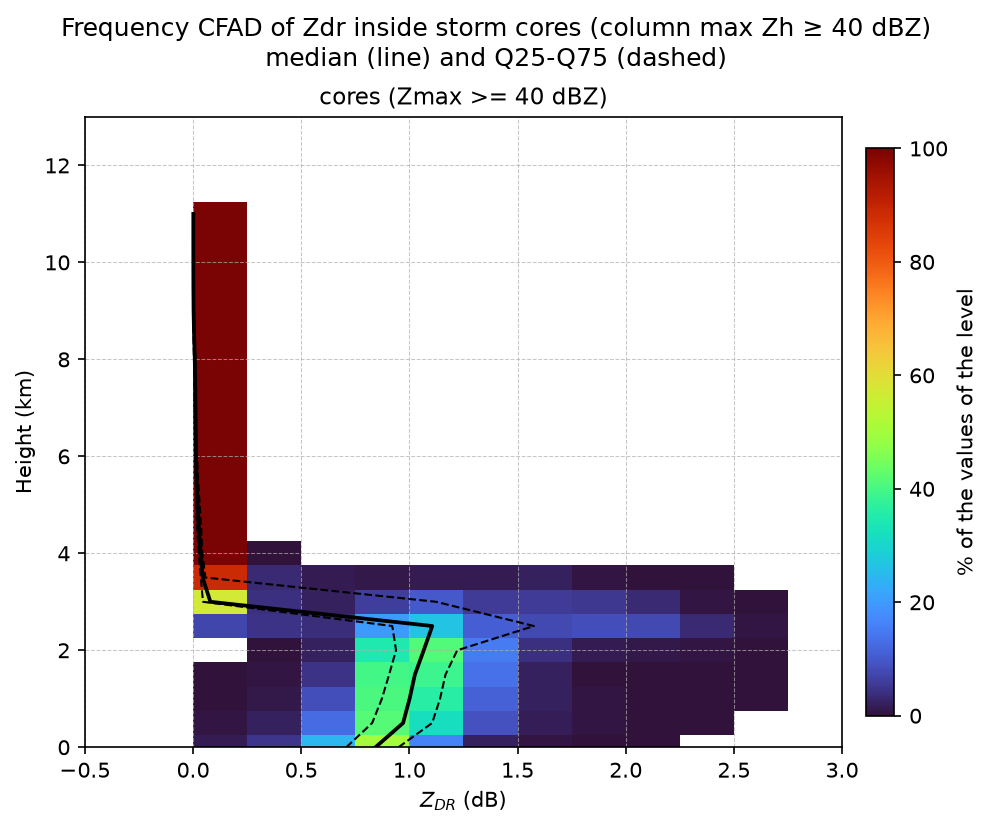

*Figure 5: frequency CFAD of Zdr in the cores (% of the values of each height), with the median and Q25-Q75.
The other variables: `cfad/core_freq_Zh.png`, `core_freq_Kdp.png`, `core_freq_Fw.png`.*

The frequency CFAD shows the full distributions: Zdr of rain spreads from 0.5 to 2.5 dB at the bottom of the
melting layer, and all values of ice are in the first bin (0-0.25 dB).

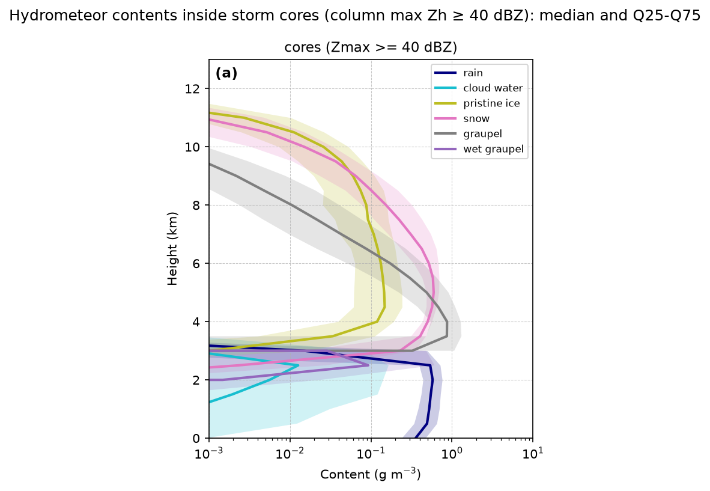

*Figure 6: contents in the cores on a log scale (`--contents-log`), which shows the small contents: pristine
ice up to 11 km, cloud water below 2.5 km.*

---

## 4. Cross-sections (`plot_cross_section.py`)

```bash
python plot_cross_section.py FILE --hmax 13
python plot_cross_section.py FILE --points 2.3 45.1 2.8 45.9 --vars Zh Zdr Kdp Ah --contents --hmax 13
```

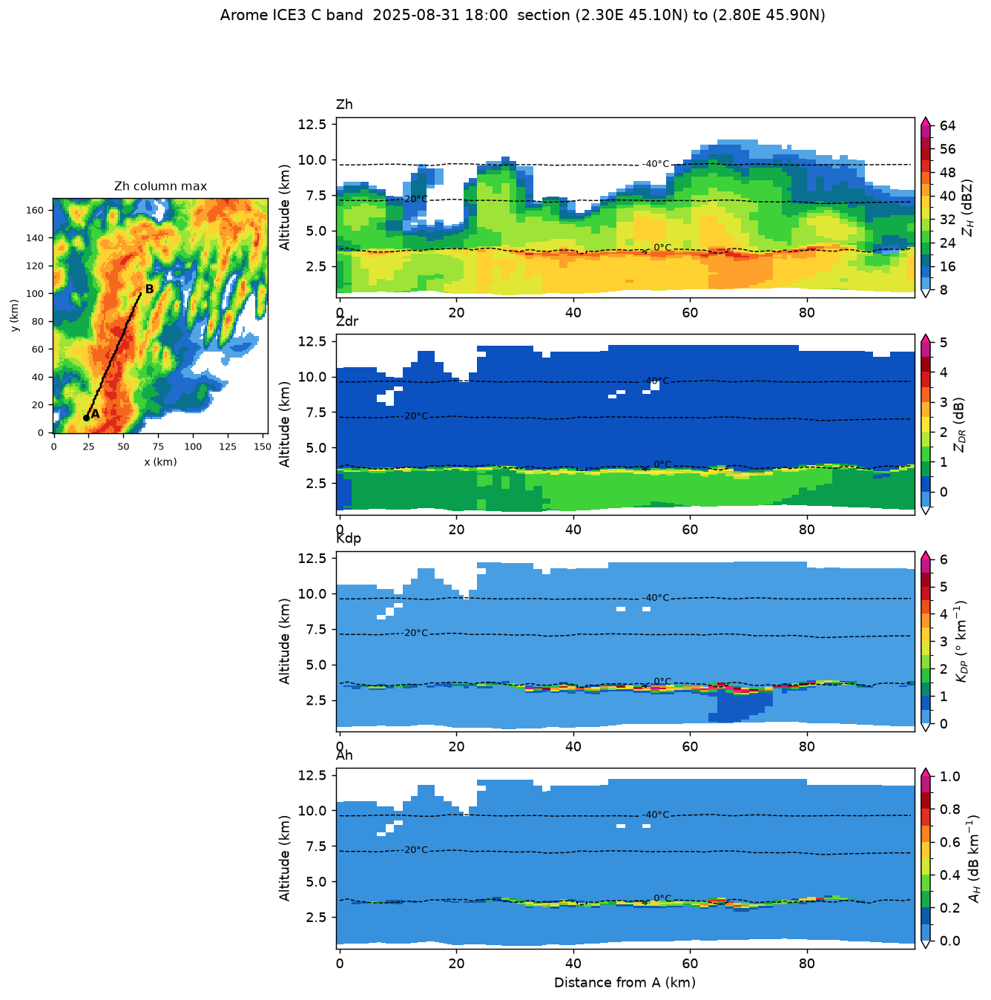

*Figure 7: section along the convective line (A: 2.3° E 45.1° N to B: 2.8° E 45.9° N) with the isotherms 0, -20
and -40 °C. Altitudes above sea level.*

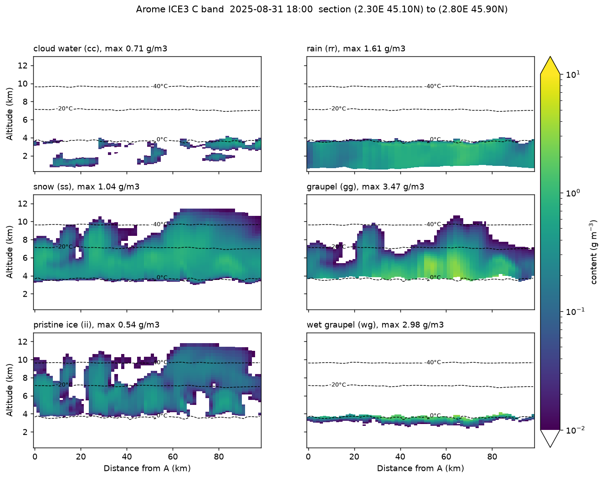

*Figure 8: contents along the same section.*

The 0 °C isotherm is at about 3.7 km altitude. The bright band and the Kdp and Ah peaks lie just below it,
where the wet graupel is (Fig. 8). Graupel reaches 3.5 g/m³ between 4 and 6 km at 50-70 km from A, under the
highest echo tops (11 km). Zdr is 1-1.5 dB in rain and close to 0 in ice. A west-east section through the
maximum of Zh is in `sections/..._section_0_11_118_11.png`.

---

## 5. Comparison with the April 2026 run (`plot_compare_outputs.py`)

The same model file was processed in April 2026 (`modelFiles/AROME/ncfiles/`). The comparison shows what the
code and table changes since then do on a real case.

```bash
python plot_compare_outputs.py APRIL_FILE NOVEMBER_FILE --labels "April 2026" "November 2026"
```

November - April, points where both runs have a value and Zh >= 0 dBZ in one of them:

| Variable | Rain (T >= 4 °C) mean / RMSE | Melting layer (0-4 °C) mean / RMSE | Ice (T < 0 °C) mean / RMSE |
|---|---|---|---|
| Zh (dB) | -0.045 / 0.08 | -0.053 / 0.11 | 0.034 / 5.8 (*) |
| Zdr (dB) | -0.001 / 0.003 | -0.003 / 0.015 | 0.000 / 0.005 |
| Kdp (°/km) | -0.001 / 0.003 | -0.005 / 0.029 | 0.000 / 0.009 |
| Ah (dB/km) | 0.000 / 0.000 | 0.000 / 0.002 | 0.000 / 0.001 |
| Zh_att (dB) | -0.044 / 0.08 | 0.39 / 5.6 | no value in April |

(*) 64 points only: the false echoes of section 2, at -400 dBZ in April and exactly 0 dBZ in November. Without
them, the 99th percentile of |difference| in ice is 0.26 dB.

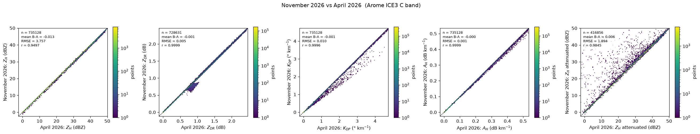

*Figure 9: November vs April for each variable (2D histograms, log colour scale).*

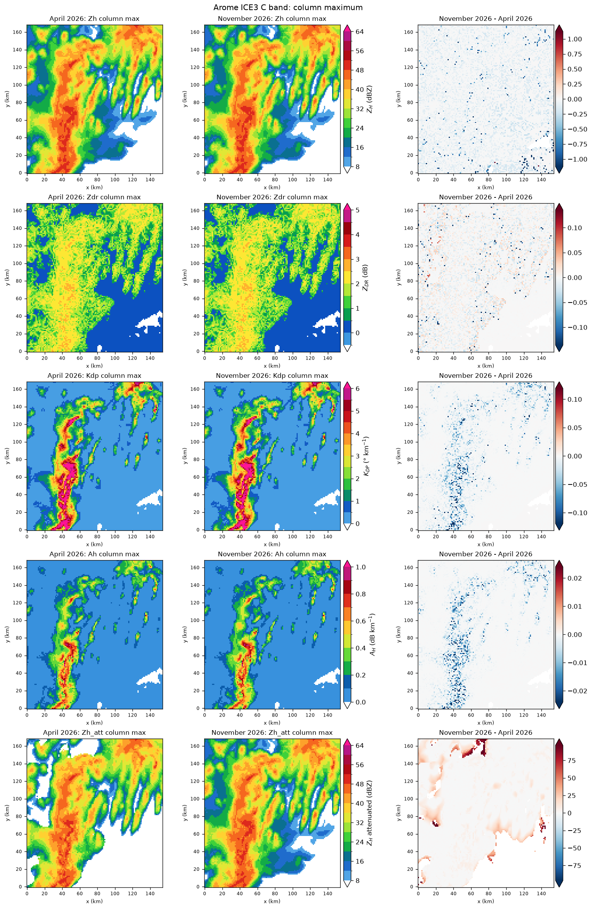

*Figure 10: column maximum in April, in November and difference.*

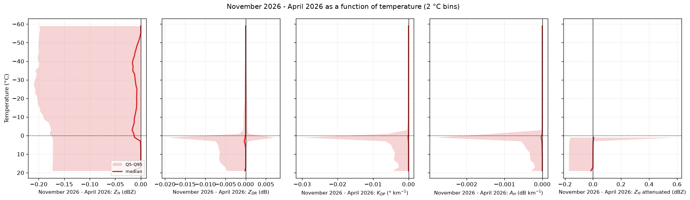

*Figure 11: median and Q5-Q95 of the difference as a function of temperature.*

* **Zh, Zdr, Kdp, Ah** hardly change: Zh is 0.05 dB lower in rain and 0.1-0.2 dB lower in ice (Q5). The
  largest changes are in the strong Kdp of the convective line, where Kdp is up to 0.1 °/km lower (Fig. 10).
  The melting layer has the largest spread (Zdr Q5 -0.02 dB, Kdp -0.03 °/km). This is consistent with the
  table changes (finer Fw step, wet graupel fixes) of the report `2026-11_lookup_tables_update.md`.
* **Zh_att** changed a lot. In April it only had values at T >= 0 °C; in November it has values in ice too
  (481 708 points have a value only in November, most of them in ice). This is why the column maximum of
  Zh_att is up to 75 dB higher in November at a few places near the edges of the cells (Fig. 10, bottom right):
  the November maximum now includes the ice levels. Where both runs have a value, Zh_att is unchanged in rain
  (-0.04 dB) but differs in the melting layer (mean +0.4 dB, RMSE 5.6 dB, 1 % of the points by more than
  6.8 dB). The attenuation code changed between the two runs; this melting-layer difference has not been
  analysed here.

---

## 6. Recomputed from the .fa file with the current code (C band)

The problems of section 2 were fixed in the code on 23 Nov. (commit c8c545e and the uncommitted changes of
`dualpol_variables.py` / `forward_operator.py`). The case was recomputed from the AROME `.fa` file with the
current code, the David2026PhD tables and the configuration `test_AROME` (attenuation computed for a radar at
the ground, `radar_altitude = 0`):

```bash
python -m operadar "historic.arome.franmg-01km30+0018:00.fa" _verif_fa_C      # environment with epygram + FA
bash docs/reports/figures_2026-11_outputs/make_figures_fa.sh python arome      # figures of sections 6-7
```

Output: `operadarFiles/AROME/fa_2026-11-24/`, figures `figures_2026-11_outputs/fa_C/`.

**Checks** (`plot_output_check.py`, `fa_C/check/..._check.txt`): nothing suspicious.

| | 20 Nov. run | .fa run, current code |
|---|---|---|
| Zh min | -418 dBZ | -30.0 dBZ (sensitivity threshold) |
| Points at exactly 0 dBZ | 6497 | 0 |
| Valid Zh points | 957 004 | 905 823 (51 181 below -30 dBZ removed) |
| Output attributes | no table information | `tables_configuration=David2026PhD`, `tables_path`, `sensitivity_threshold=True` |
| Zdr in ice (median, T <= -10 °C) | ~0 dB | 0.41 dB |
| Zh_att max | 51.0 dBZ | 50.9 dBZ |

.fa run - 20 Nov. (`plot_compare_outputs.py`, points where both runs have a value and Zh >= 0 dBZ):

| Variable | Rain (T >= 4 °C) mean / RMSE | Melting layer (0-4 °C) mean / RMSE | Ice (T < 0 °C) mean / RMSE |
|---|---|---|---|
| Zh (dB) | +0.03 / 0.08 | +0.00 / 0.11 | +0.22 / 0.29 |
| Zdr (dB) | -0.05 / 0.06 | -0.17 / 0.27 | +0.36 / 0.59 |
| Kdp (°/km) | -0.01 / 0.02 | -0.13 / 0.35 | +0.05 / 0.11 |
| Ah (dB/km) | 0.000 / 0.000 | 0.000 / 0.003 | 0.000 / 0.001 |
| Zh_att (dB) | +0.03 / 0.08 | +0.00 / 0.11 | +0.22 / 0.29 |

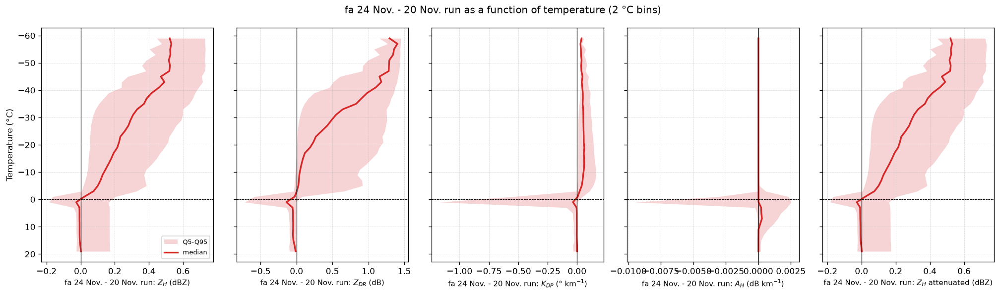

*Figure 12: difference between the .fa run (current code, David2026PhD tables) and the run of 20 Nov., as a
function of temperature.*

* The differences come from the tables. **Ice:** Zdr is now positive (oblate pristine ice and snow of
  David2026PhD, plates with aspect ratio 0.2). In the cores the Zdr median grows with height, from 0.06 dB at
  6 km to 0.41 dB at 8 km and 1.25 dB at 10 km, where pristine ice dominates. Kdp in ice is +0.05 °/km.
  **Melting layer:** Zdr -0.17 dB and Kdp -0.13 °/km (canting of the wet graupel). **Rain:** Zdr -0.05 dB.
  Zh hardly changes (+0.03 dB in rain, +0.2 dB in ice), partly because of the interpolation fix
  (`np.floor` -> `np.rint`).
* **Zh_att** changes exactly like Zh: the attenuation computed on 20 Nov. and today is the same. The large
  melting-layer difference of section 5 (April vs November, RMSE 5.6 dB) therefore comes from the attenuation
  code changes made before 20 Nov., not from the changes of this branch. At C band the attenuation is small
  here: Zh_att is 0.1 dB below Zh at 2 km in the cores and 0.3-0.5 dB above the melting layer.
* The CFADs of the cores are unchanged below 6 km (Zh within 0.2 dB at all heights); 2821 core columns
  instead of 2867 (1.6 % fewer).
* **Check of the shortcut used before:** the first version of this section was computed from the model fields
  stored in the 20 Nov. output (`rerun_from_output.py`, written when the FA library was not available). The
  .fa run gives exactly the same Zh, Zdr, Kdp and Ah (all differences 0.000, `fa_C/compare_rerun/`), so that
  shortcut is valid for outputs with `Fw_posg`. Only the attenuation needs the .fa file.

Medians in the cores (.fa run):

| Height (km) | Zh (dBZ) | Zh_att (dBZ) | Zdr (dB) | Kdp (°/km) |
|---|---|---|---|---|
| 0 | 34.4 | 34.4 | 0.77 | 0.12 |
| 2 | 38.0 | 37.9 | 0.97 | 0.27 |
| 2.5 | 39.1 | 39.0 | 0.97 | 0.42 |
| 3 | 35.3 | 35.0 | 0.04 | 0.08 |
| 4 | 30.5 | 30.1 | 0.03 | 0.08 |
| 6 | 26.0 | 25.7 | 0.06 | 0.09 |
| 8 | 15.8 | 15.3 | 0.41 | 0.08 |
| 10 | 5.9 | 5.6 | 1.25 | 0.04 |

---

## 7. W band compared with C band

The same case was computed at W band (94 GHz, David2026PhD tables, regenerated on 24 Nov. with the snow
expDmax reduced to 1.96, see the verification report), from the .fa file (`_verif_fa_W`, same configuration).
Figures in `fa_W/`.

At W band the reflectivity of convective cores never reaches 40 dBZ (maximum 27.8 dBZ), so the default core
mask selects no column. The W band CFADs therefore use **the cores of the C band** (same grid), with the new
option `--cells-from` of `compute_cfad.py`. `--zh-min -50` keeps the weak W band values (sensitivity of a
cloud radar):

```bash
python compute_cfad.py W.nc --cells-from C.nc --label "W band, C band cores" --mask core \
       --vars Zh Zh_att Zdr Kdp --zh-min -50 --out stats/core_Ccells.nc
python plot_cfad.py stats/C_core.nc stats/core_Ccells.nc --labels "C band" "W band" --figs radar freq --diff
```

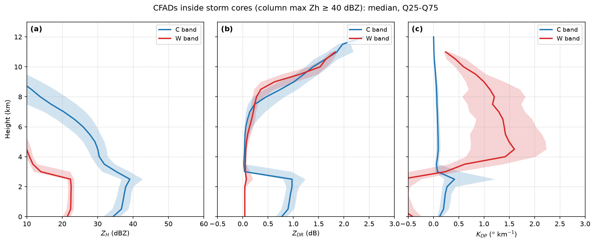

*Figure 13: median and Q25-Q75 of Zh, Zdr and Kdp at C band (blue) and W band (red) in the C band cores
(2821 columns). Points with Zh >= -50 dBZ at each band.*

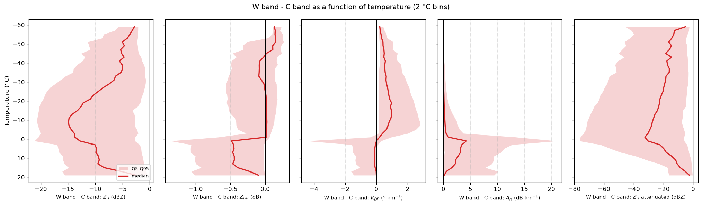

*Figure 14: W band - C band as a function of temperature (points where Zh >= -10 dBZ at one of the bands).*

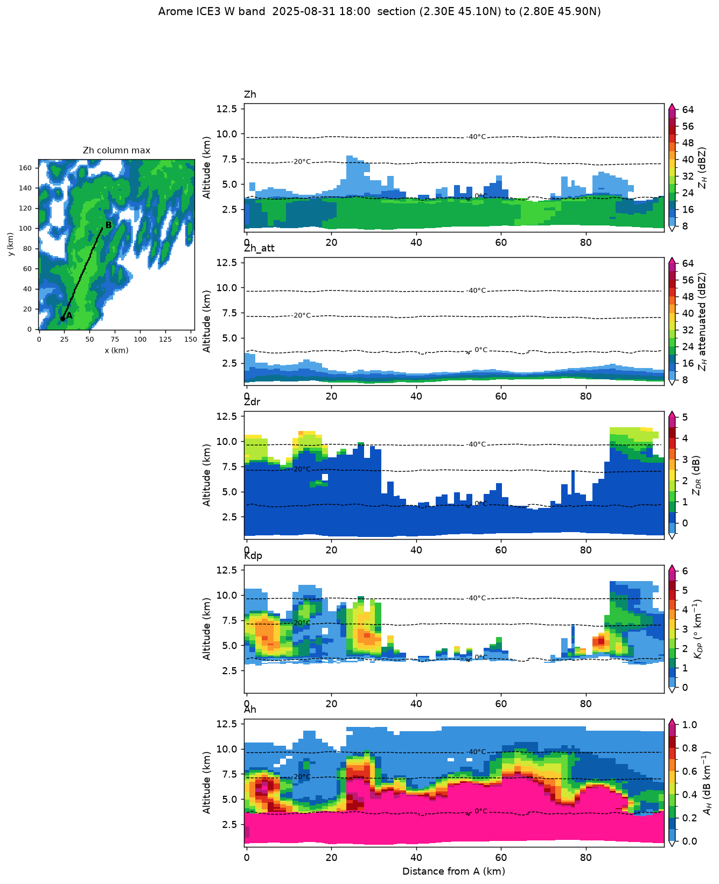

*Figure 15: W band section along the convective line (same as Fig. 7): Zh, Zh_att (radar at the ground looking
up), Zdr, Kdp and Ah.*

| Height (km) | Zh C / W (dBZ) | Zh_att C / W (dBZ) | Zdr C / W (dB) | Kdp C / W (°/km) |
|---|---|---|---|---|
| 0 | 34.4 / 21.4 | 34.4 / 21.4 | 0.77 / 0.04 | 0.12 / -0.41 |
| 1 | 37.2 / 22.4 | 37.1 / 9.0 | 0.92 / 0.04 | 0.22 / -0.68 |
| 2 | 38.0 / 22.5 | 37.9 / -6.0 | 0.97 / 0.04 | 0.27 / -0.68 |
| 3 | 35.3 / 14.0 | 35.0 / -25 | 0.04 / 0.05 | 0.08 / 0.24 |
| 4 | 30.5 / 10.8 | 30.1 / < -30 | 0.03 / 0.05 | 0.08 / 1.42 |
| 6 | 25.9 / 6.1 | 25.6 / < -30 | 0.06 / 0.14 | 0.09 / 1.40 |
| 8 | 13.8 / 3.1 | 13.4 / < -30 | 0.41 / 0.27 | 0.08 / 1.20 |
| 10 | 0.9 / -4.2 | 0.6 / < -30 | 1.25 / 1.53 | 0.04 / 0.60 |

(C band medians of this table with `--zh-min -50`, so slightly different from section 6 above 6 km.)

Everything is consistent with the scattering of particles of the size of the wavelength (3.2 mm at W band,
Mie regime):

* **Zh** is 9-16 dB lower than at C band (mean -8.8 dB in rain, -10.6 dB in ice). In rain it saturates near
  22 dBZ whatever the rain content: at 10 g/m³ the table gives 33 dBZ at W band and 60 dBZ at C band. The
  difference is largest near -10 °C (-16 dB, large graupel and snow) and smallest at high levels (-4 dB at
  -55 °C, small pristine ice, close to Rayleigh).
* **Zdr** of rain is almost 0 (0.04 dB) at W band against 1 dB at C band: the large drops, which give the Zdr
  at C band, are in resonance. In ice, Zdr is close to the C band value and grows with height in the same way.
* **Kdp** is **negative in rain** (-0.4 to -0.7 °/km in the cores, down to -10 °/km at the heaviest points)
  and in the melting layer, and positive in ice (1.2-1.4 °/km, 15-17 times the C band value, close to the
  ratio of the frequencies). The negative values come from the tables: at W band the T-matrix Kdp of rain is
  negative for all contents (-1.6 °/km at 1 g/m³), while the Rayleigh column `kdpR` is positive (+6.6 °/km).
  This is the known sign change of Kdp of raindrops at millimetre wavelengths. `plot_output_check.py` now
  reports these values as expected at Ka and W band instead of a warning.
* **Attenuation:** Ah is 3.3 dB/km higher than at C band on average in rain and 5.6 dB/km in the melting
  layer, up to 45 dB/km (maximum 1 dB/km at C band). For a radar at the ground looking up, **Zh_att in the
  cores drops from 21 dBZ at the ground to -6 dBZ at 2 km and below -25 dBZ at 3 km**: the W band radar
  sees almost nothing above the melting layer (Fig. 15). Where the W band radar still detects a signal, Zh - Zh_att
  is 1.5 dB (median) in rain, 13 dB in the melting layer and 11 dB in ice; W band Zh_att is 14 dB below the
  C band Zh_att on average in rain and 28-31 dB below in the melting layer and ice. 8 % of the points with precipitation (42 744) are below the
  sensitivity after attenuation and have no radar variable.
* **Sensitivity:** the default threshold at W band is -50 dBZ (cloud radar). `plot_output_check.py` now uses
  the threshold of the band (it gave a false warning at -30 dBZ), and reports the points removed by the
  sensitivity after attenuation as information (they have Ah but no Zh) instead of "outside the tables?".

Other W band figures: `fa_W/check/` (maps, joint distributions, temperature), `fa_W/cfad/C_vs_W_core_freq_*.png`
(frequency CFADs of both bands with their difference), `fa_W/compare/` (scatter and maps).

---

## 8. MesoNH case (3BL13, cyclone near La Réunion)

| | |
|---|---|
| Model file | `modelFiles/MesoNH/3BL13.1.MXX25.004.nc` (40 GB): MesoNH, ICE3, 15 January 2024 04 UTC, 1202 x 1202 points at 2.5 km, 82 levels, 5-32° S, 41-70° E |
| Former output | `modelFiles/MesoNH/dpolvar_MesoNH_ICE3_Cband_20240115_0400.nc` (20 Nov., whole domain; the tables are not recorded, probably `improved`, the path of `test_MesoNH`) |
| New run | current code, David2026PhD tables, C band, attenuation, **subdomain 53-60° E, 24-17° S** (293 x 313 points), `configFiles/_verif_mesonh_C.py`: `operadarFiles/MesoNH/2026-11-24/` |

```bash
python -m operadar 3BL13.1.MXX25.004.nc _verif_mesonh_C        # 59 s
bash docs/reports/figures_2026-11_outputs/make_figures_fa.sh python mesonh   # 46 s, figures in mesonh/, mesonh_old/
```

**The MesoNH reading did not work** (also on master): five bugs, fixed in this branch and covered by the new
tests `tests/test_read_mesonh.py` (synthetic MesoNH file; the tests fail without the fixes):

1. `operadar/read/with_netCDF4.py`: a type annotation `tuple(dict[...], np.ndarray)` instead of
   `tuple[...]` raised a `TypeError` at import, so no MesoNH file could be read.
2. `operadar/read/mesonh.py`: `check_variable_is_in_dataset` and `get_subdomain_indices` were called without
   their module prefix (`readnc.`): `NameError`.
3. `operadar/read/mesonh.py`: without subdomain the indices were `0, -1`, and `[0:-1]` dropped the last row
   and column of the domain (the former output has 1201 x 1201 points instead of 1202 x 1202). Now `None`.
4. `with_netCDF4.get_subdomain_indices`: the end indices were the last point inside the box, used as slice
   ends (exclusive): the last row and column of the subdomain were dropped. Now `+ 1`.
5. `with_netCDF4.get_contents`: the water vapour (`RVT`) was read but not kept, and `qv` was returned as
   `np.empty(...)` (uninitialised memory). `qv` is used for the gas attenuation. In this run the result was
   the same with the fix (Zh_att differs by less than 1e-5 dB: `np.empty` most likely reused the memory of the
   discarded RVT array), but it is undefined, and at W band the water vapour changes the gas attenuation from
   0.02 to 1.7 dB/km (25 °C, 20 g/kg).

**Memory:** on the whole domain (118 million points per 3D field) operadar was killed by the system (out of
memory, 23 GB available). The new run therefore uses a subdomain around the most intense part of the cyclone
(column maximum Zh up to 60 dBZ near 57° E, 20° S, half of the 40 dBZ core columns of the domain). The plot tools
work on the whole former output (8 GB) without problem (CFADs in 3 s).

### 8.1 Checks

| | Former output (whole domain) | New run (subdomain) |
|---|---|---|
| Zh min | -451 dBZ | -30.0 dBZ |
| Points at exactly 0 dBZ | **1 365 628** (11 % of the Zh values) | 0 |
| Points with Zh < -30 dBZ | 1 590 817 | 0 |
| Zh max | 60.0 dBZ | 60.0 dBZ |
| Checks | 2 warnings (sensitivity, 0 dBZ) | nothing suspicious |

The false echoes at 0 dBZ are much more numerous than in the AROME file (the former Zh median over the whole
domain is exactly 0.000 dBZ): **the former MesoNH output should not be used for statistics** (CFADs over all
points, Zh distributions) without removing them. `plot_output_check.py` now detects them.

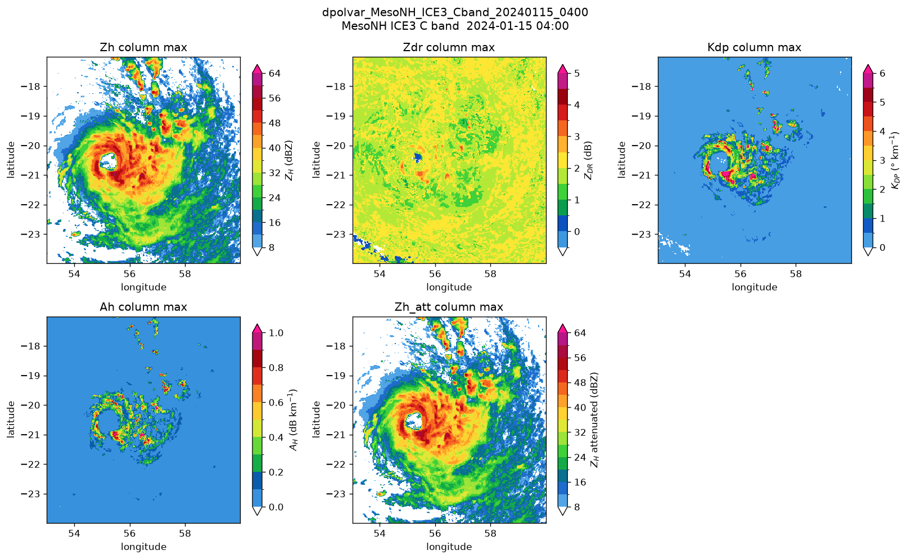

*Figure 16: column maximum of Zh, Zdr, Kdp, Ah and Zh_att (new run, subdomain). Eye of the cyclone at 55.2° E,
20.7° S, eyewall and rain bands up to 60 dBZ, Kdp up to 13.6 °/km.*

The column maximum of Zdr is about 2 dB everywhere, even where Zh is weak: it comes from the top of the
clouds, where Zdr increases regularly as the temperature decreases (median 0.1 dB at -10 °C, 0.5 dB at
-35 °C, 1.0 dB at -50 °C, 1.4 dB at -70 °C, with Zh around 0 dBZ), as snow becomes scarce and pristine ice
(plates of David2026PhD) dominates. With observations, a sensitivity threshold depending on the range would
remove most of these weak echoes at high altitude.

### 8.2 CFADs and section

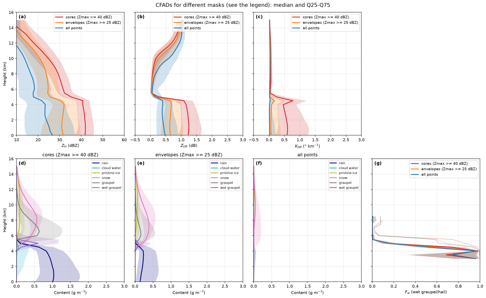

*Figure 17: CFADs in the cores (30 cores, 7806 columns), envelopes (24 013 columns) and all points of the
subdomain. Heights above the ground (sea).*

| Height (km) | Zh (dBZ) | Zh_att (dBZ) | Zdr (dB) | Kdp (°/km) | Rain | Graupel | Snow | Wet graupel (g/m³) |
|---|---|---|---|---|---|---|---|---|
| 0 | 41.8 | 41.8 | 1.22 | 0.58 | 1.01 | 0 | 0 | 0 |
| 2 | 41.7 | 41.5 | 1.23 | 0.57 | 1.00 | 0 | 0 | 0 |
| 4 | 40.7 | 40.2 | 1.16 | 0.46 | 0.83 | 0 | 0 | 0 |
| 4.5 | 40.8 | 40.3 | 1.08 | 0.77 | 0.63 | 0 | 0 | 0.13 |
| 5 | 35.3 | 34.5 | 0.25 | 0.25 | 0.11 | 0 | 0.16 | 0.60 |
| 6 | 31.6 | 30.8 | 0.02 | 0.04 | 0 | 0.57 | 0.41 | 0 |
| 8 | 29.3 | 28.5 | 0.07 | 0.06 | 0 | 0.40 | 0.57 | 0 |
| 10 | 24.8 | 23.9 | 0.18 | 0.06 | 0 | 0.06 | 0.37 | 0 |
| 12 | 18.1 | 17.1 | 0.69 | 0.05 | 0 | 0.01 | 0.12 | 0 |
| 14 | 10.7 | 9.6 | 0.94 | 0.03 | 0 | 0 | 0.03 | 0 |

* **Tropical profile:** melting layer at 4.5-5.5 km (0 °C near 5 km), echo tops above 14 km.
* **Rain:** in the cores Zh (42 dBZ), Zdr (1.2 dB), Kdp (0.6 °/km) and the rain content (1 g/m³) are almost
  constant from the melting layer to the sea. Unlike the AROME case (section 3), there is no decrease towards
  the ground: no strong evaporation in the saturated cyclone.
* **Melting layer:** Kdp peak 0.77 °/km at 4.5 km, wet graupel 0.6 g/m³ at 5 km, Fw from 1 to 0 between 4 and
  5.5 km.
* **Ice:** graupel dominates at 6 km (0.57 g/m³), snow above (0.57 g/m³ at 8 km). Zdr is close to 0 between
  5.5 and 9 km, then increases with height (pristine ice).
* **Attenuation:** at C band, Zh_att is less than 1 dB below Zh in the median profile of the cores; over all
  points Zh - Zh_att is below 1.8 dB for 99 % of the points, up to 14.5 dB above the strongest rain bands
  (Fig. 18).

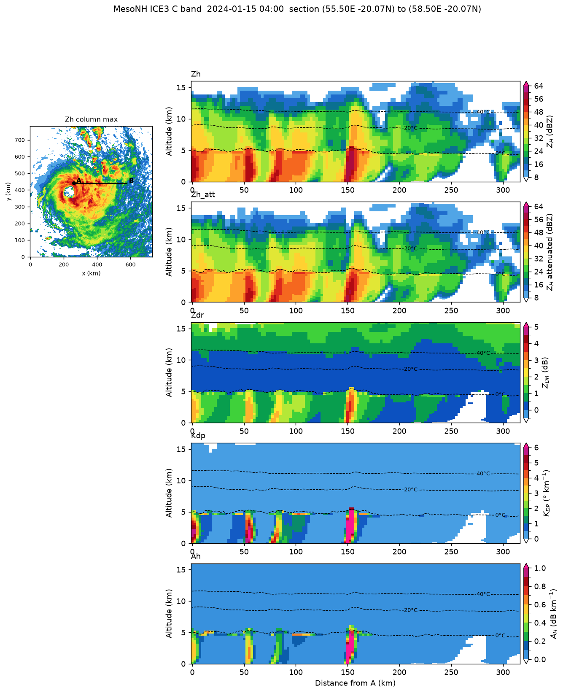

*Figure 18: west-east section at 20.07° S through the maximum of Zh (55.5 to 58.5° E), from the eyewall to the
outer rain bands.*

### 8.3 Comparison with the former output

The former output covers the whole domain; `plot_compare_outputs.py` now finds the subdomain in it (lat/lon of
the first point) and compares the 313 x 293 common points:

| Variable | Rain (T >= 4 °C) mean / RMSE | Melting layer (0-4 °C) mean / RMSE | Ice (T < 0 °C) mean / RMSE |
|---|---|---|---|
| Zh (dB) | +0.002 / 0.004 | -0.02 / 0.06 | +0.03 / 0.05 |
| Zdr (dB) | -0.001 / 0.003 | -0.08 / 0.19 | +0.006 / 0.02 |
| Kdp (°/km) | 0.000 / 0.004 | -0.07 / 0.24 | +0.003 / 0.03 |

The former output was probably computed with the `improved` tables, which already had oblate ice: the only
noticeable difference is in the melting layer (wet graupel canting of David2026PhD), as for AROME. The CFADs
of the cores over the whole former domain (215 cores, `mesonh_old/stats/core.nc`) are close to those of the
subdomain (Zh 41.8 dBZ and Zdr 1.23 dB at the ground).

---

## 9. Points to follow up

1. ~~Recompute the AROME file with the current code~~, ~~write the table configuration in the outputs~~ and
   ~~check Zh_att from the .fa file~~: done (sections 6-7). The 0 dBZ false echoes and the values below
   -30 dBZ are gone.
2. **Geometry of the attenuation in the test configurations:** `test_AROME` and `test_MesoNH` compute Zh,
   Zdr and Kdp for a horizontal beam (`cnst_angle = 0`) but the attenuation for a radar at the ground looking
   up (`radar_altitude = 0`). A real vertically pointing radar would see Zdr and Kdp close to 0. This
   is fine for a test, but the combination should be explained in the template, or `cnst_angle = 90` used
   when the vertical attenuation is wanted.
3. **MesoNH on large domains:** the whole 1202 x 1202 x 82 domain does not fit in 23 GB. Processing by
   blocks of columns (or float32 fields) would allow it; meanwhile use `subDomain`.
4. Former outputs (AROME of 20 Nov., MesoNH) contain false 0 dBZ echoes: recompute them before any statistics.
5. With observations of the case (on a Cartesian grid), the same commands give the simulation-observation
   comparison of David et al. (2025): `compute_cfad.py OBS.nc --label obs --core-dbz 48`, then
   `plot_cfad.py obs.nc core.nc --figs summary freq --diff`.
